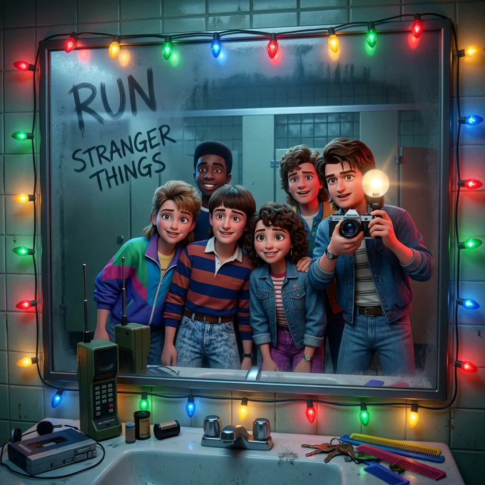

# Mirror selfie scene inspired by a retro 80s sci-fi

[← Back to the collection](../../README.md) · Category: [Illustration & 3D](../../gallery/illustration-3d.md) · Model: `Vinano Image v2` · ID: `vn-00191`

<a href="https://vinano.ai?utm_source=github&utm_medium=readme&utm_campaign=awesome-image-video-prompts-updating&utm_content=prompt-page-image"></a>

<sub>Preview generated with <a href="https://vinano.ai?utm_source=github&utm_medium=readme&utm_campaign=awesome-image-video-prompts-updating&utm_content=prompt-page-caption">vinano.ai</a></sub>

## Prompt

```text
Cinematic mirror selfie scene inspired by a retro 80s sci-fi horror vibe, a group of teenagers and a photographer posing together in a bathroom mirror, vintage camera flash lighting, Christmas string lights around the mirror, walkie-talkies and retro gadgets on the sink, handwritten fog text on the mirror reading “RUN” and “Stranger Things”, nostalgic atmosphere, moody blue and red lighting, cinematic storytelling composition, Pixar-style 3D characters, ultra-detailed, soft reflections, 8K. Preserve realistic proportions and depth for a confident, professional finish.
```

## Try it on vinano.ai

1. Copy the prompt above.
2. Open **[vinano.ai](https://vinano.ai?utm_source=github&utm_medium=readme&utm_campaign=awesome-image-video-prompts-updating&utm_content=prompt-page-try)**, paste it into the image generator and pick a model.
3. Swap any placeholders (brand, product, city, person…) for your own details, then generate.

More prompts like this: [Illustration & 3D gallery](../../gallery/illustration-3d.md) · [all categories](../../README.md#contents)
