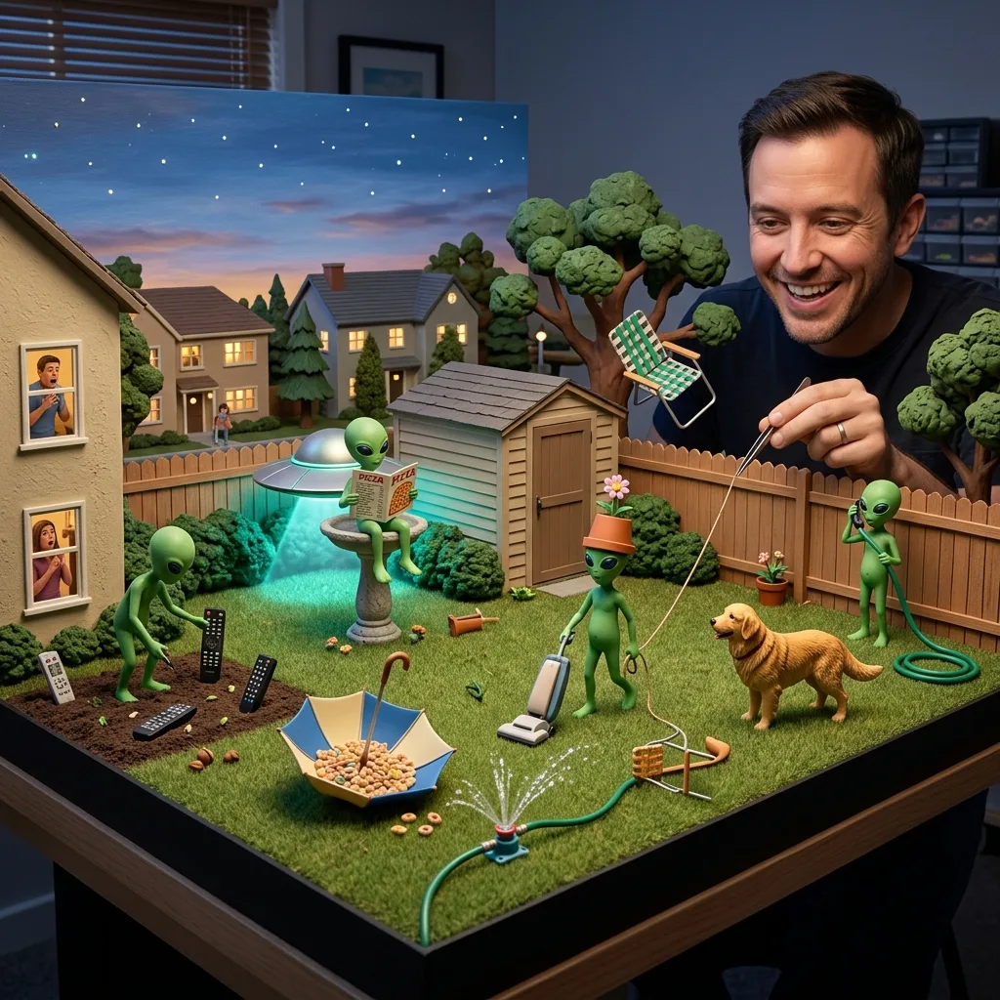

# Photography, medium-wide shot

[← Back to the collection](../../README.md) · Category: [Illustration & 3D](../../gallery/illustration-3d.md) · Model: `Vinano Image Pro` · ID: `vn-00197`

<a href="https://vinano.ai?utm_source=github&utm_medium=readme&utm_campaign=awesome-image-video-prompts-updating&utm_content=prompt-page-image"></a>

<sub>Preview generated with <a href="https://vinano.ai?utm_source=github&utm_medium=readme&utm_campaign=awesome-image-video-prompts-updating&utm_content=prompt-page-caption">vinano.ai</a></sub>

## Prompt

```text
Professional photography, medium-wide shot. A massive, realistic diorama world filling the entire workspace horizon, depicting a cross-section of a suburban backyard where a confused alien is hilariously misusing everyday Earth objects. The structure features a typical wooden fence and garden shed merged a UFO partially hidden behind bushes (soft LED underglow). Intricate details include a miniature green alien figurine wearing a flower pot as a hat, attempting to "walk" a vacuum cleaner on a leash like a dog, a garden hose as a telephone, sitting in a birdbath fully clothed reading a pizza menu upside-down, and trying to plant TV remote controls in soil like seeds. A confused golden retriever figurine watches head tilted. On the patio, miniature human figures peek through window curtains looking shocked and bewildered. The lawn features misplaced items: umbrella stuck in ground upside-down filled cereal, lawn chair hanging from tree branch, sprinkler shooting water straight up. The background consists entirely of physical 3D forms, featuring sculpted foam neighboring houses lights on, clay trees, and a painted evening sky tiny stars, absolutely no flat backdrops. A realistic human artisan is positioned in the back-right background, actively working on the scene, fine tweezers to adjust the tiny vacuum cleaner "leash," grinning widely at the absurdity. Dual-layer workspace lighting combines warm evening suburban lighting plus soft UFO glow (blue-green LED) to highlight the contrast between normal suburban textures and surreal alien confusion. Compose the scene for a 9:16 vertical aspect ratio balanced framing and no cropped elements. Ensure all primary subjects, key actions, and facial features remain within a central safe zone, avoiding edge cropping across the selected aspect ratio. If a human creator or artisan is present in the scene, render the person as a realistic individual. Use the uploaded image reference as the exact facial identity of the creator. Maintain consistent facial structure, proportions, and likeness. Do not reinterpret, stylize, or substitute the face. Keep edges clean and the overall composition balanced for a polished, gallery-ready result.
```

## Try it on vinano.ai

1. Copy the prompt above.
2. Open **[vinano.ai](https://vinano.ai?utm_source=github&utm_medium=readme&utm_campaign=awesome-image-video-prompts-updating&utm_content=prompt-page-try)**, paste it into the image generator and pick a model.
3. Swap any placeholders (brand, product, city, person…) for your own details, then generate.

More prompts like this: [Illustration & 3D gallery](../../gallery/illustration-3d.md) · [all categories](../../README.md#contents)
