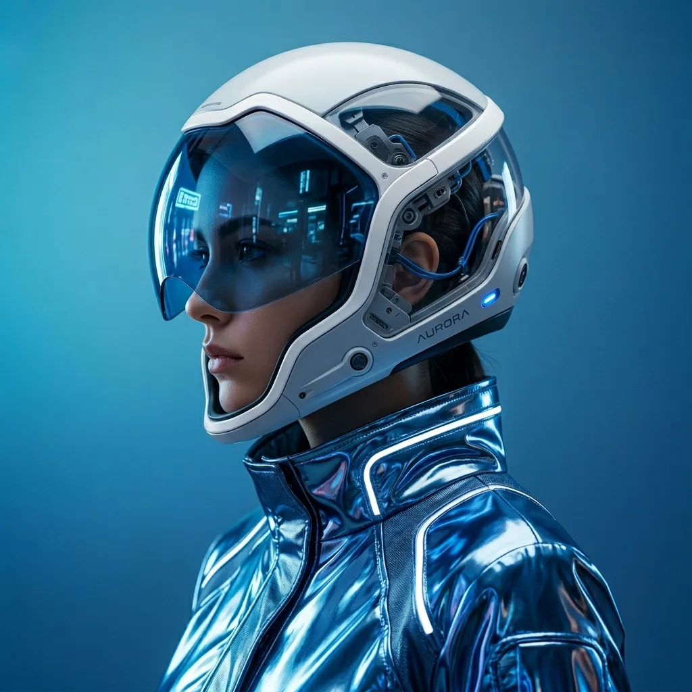

# Futuristic portrait of a young woman in side profile

[← Back to the collection](../../README.md) · Category: [Illustration & 3D](../../gallery/illustration-3d.md) · Model: `Vinano Image Pro` · ID: `vn-00200`

<a href="https://vinano.ai?utm_source=github&utm_medium=readme&utm_campaign=awesome-image-video-prompts-updating&utm_content=prompt-page-image"></a>

<sub>Preview generated with <a href="https://vinano.ai?utm_source=github&utm_medium=readme&utm_campaign=awesome-image-video-prompts-updating&utm_content=prompt-page-caption">vinano.ai</a></sub>

## Prompt

```text
Ultra-realistic futuristic portrait of a young woman in side profile facing left, wearing a reflective metallic blue chrome jacket and a sleek sci-fi helmet a large glossy visor covering her eyes. The helmet has smooth curves, white accents, and transparent side panels subtle mechanical details. The visor reflects light a blue tint, giving a cyberpunk / space-age aesthetic. Minimalistic composition a solid gradient blue background. Soft filmic, cinematic lighting high contrast and glossy reflections on the jacket and helmet. Sharp focus on the face and textures, shallow depth of field, studio-quality, 8K, hyper-detailed, clean and modern fashion editorial style. Keep edges clean and the overall composition balanced for a polished, gallery-ready result.
```

## Try it on vinano.ai

1. Copy the prompt above.
2. Open **[vinano.ai](https://vinano.ai?utm_source=github&utm_medium=readme&utm_campaign=awesome-image-video-prompts-updating&utm_content=prompt-page-try)**, paste it into the image generator and pick a model.
3. Swap any placeholders (brand, product, city, person…) for your own details, then generate.

More prompts like this: [Illustration & 3D gallery](../../gallery/illustration-3d.md) · [all categories](../../README.md#contents)
