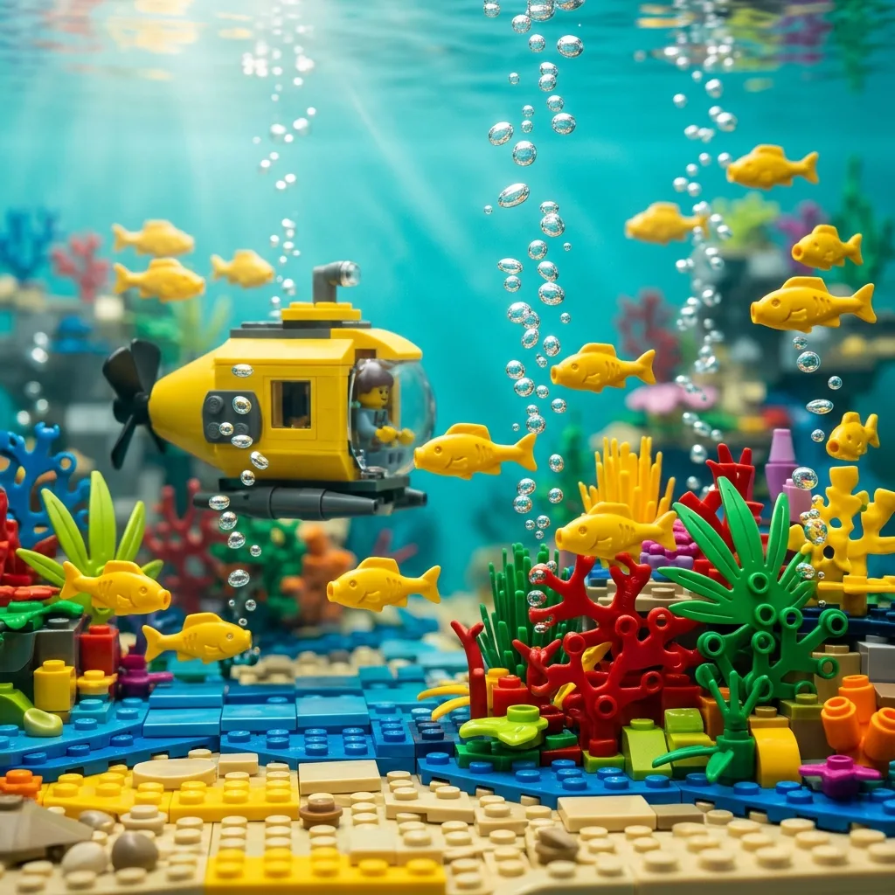

# Surrounding the submarine are multiple small bright yellow LEGO

[← Back to the collection](../../README.md) · Category: [Illustration & 3D](../../gallery/illustration-3d.md) · Model: `Vinano Image v2` · ID: `vn-00208`

<a href="https://vinano.ai?utm_source=github&utm_medium=readme&utm_campaign=awesome-image-video-prompts-updating&utm_content=prompt-page-image"></a>

<sub>Preview generated with <a href="https://vinano.ai?utm_source=github&utm_medium=readme&utm_campaign=awesome-image-video-prompts-updating&utm_content=prompt-page-caption">vinano.ai</a></sub>

## Prompt

```text
Surrounding the submarine are multiple small bright yellow LEGO fish swimming at different depths, several air bubbles rising upward in sharp detail. The seabed is made of LEGO bricks, including textured sand, blue tiles, and colorful coral elements in red, green, and yellow. The water is clear turquoise soft light rays filtering from above, creating realistic underwater caustics and reflections.

Shallow depth of field (f/1.8), strong bokeh background, 50mm lens, ultra-realistic lighting, vibrant colors, high detail, professional macro photography style.

Maintain consistent colour harmony and crisp focus across the whole frame.
```

## Try it on vinano.ai

1. Copy the prompt above.
2. Open **[vinano.ai](https://vinano.ai?utm_source=github&utm_medium=readme&utm_campaign=awesome-image-video-prompts-updating&utm_content=prompt-page-try)**, paste it into the image generator and pick a model.
3. Swap any placeholders (brand, product, city, person…) for your own details, then generate.

More prompts like this: [Illustration & 3D gallery](../../gallery/illustration-3d.md) · [all categories](../../README.md#contents)
