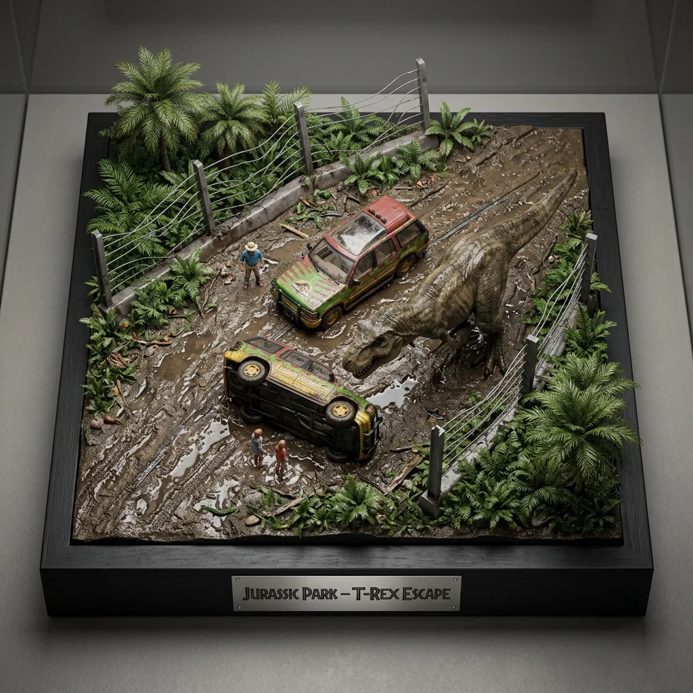

# Ultra-detailed large-scale miniature diorama of the ICONIC SCENE

[← Back to the collection](../../README.md) · Category: [Illustration & 3D](../../gallery/illustration-3d.md) · Model: `Vinano Image Pro` · ID: `vn-00209`

<a href="https://vinano.ai?utm_source=github&utm_medium=readme&utm_campaign=awesome-image-video-prompts-updating&utm_content=prompt-page-image"></a>

<sub>Preview generated with <a href="https://vinano.ai?utm_source=github&utm_medium=readme&utm_campaign=awesome-image-video-prompts-updating&utm_content=prompt-page-caption">vinano.ai</a></sub>

## Prompt

```text
Ultra-detailed large-scale miniature diorama of the [ICONIC SCENE] from [MOVIE/SHOW] presented as a premium museum-quality desktop exhibition model.
True scale model craftsmanship extreme fine detail.
[ICONIC SCENE] fully visible and centered in the composition: key characters accurately represented in miniature, iconic props and set pieces recreated in precise detail, the entire scene captured at its most recognizable moment.
Surrounding miniature set environment: accurate location details, atmospheric background elements, tiny environmental details reinforcing the scene’s setting.
Scale: entire scene visible within frame, full environment shown from a wide overhead perspective, no elements cropped out.
Ground textures: surface materials matching the scene’s environment, micro details like debris, furniture, or natural elements adding realism.
Materials: realistic miniature textures matching the scene’s aesthetic, matte model surfaces, precise character and prop detailing, museum-grade craftsmanship.
Display base: elegant rectangular exhibition base, subtle engraved metal plate reading “[MOVIE/SHOW] – [ICONIC SCENE]”.
Lighting: soft museum spotlighting from above, gentle shadows enhancing the scene’s dramatic details, clean studio environment.
Camera: wide elevated bird’s-eye overview angle showing the entire diorama from above, tilt-shift miniature aesthetic, full scene visible from edge to edge, center extremely sharp slight edge depth falloff, no close-up cropping.
Ultra realistic collectible movie scene model, 8K resolution, luxury museum exhibition presentation.
Aspect ratio 4:5 vertical.​​​​​​​​​​​​​​​​

Emphasise material texture and natural light so the final frame feels tactile and premium.
```

## Try it on vinano.ai

1. Copy the prompt above.
2. Open **[vinano.ai](https://vinano.ai?utm_source=github&utm_medium=readme&utm_campaign=awesome-image-video-prompts-updating&utm_content=prompt-page-try)**, paste it into the image generator and pick a model.
3. Swap any placeholders (brand, product, city, person…) for your own details, then generate.

More prompts like this: [Illustration & 3D gallery](../../gallery/illustration-3d.md) · [all categories](../../README.md#contents)
