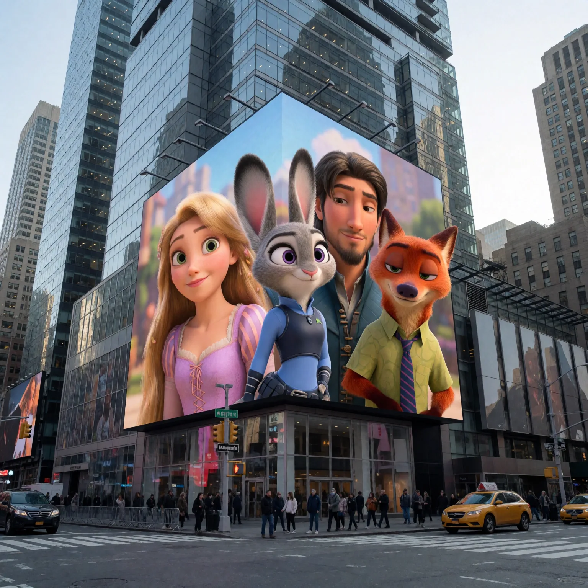

# High-end cinematic 3D

[← Back to the collection](../../README.md) · Category: [Illustration & 3D](../../gallery/illustration-3d.md) · Model: `Vinano Flash` · ID: `vn-00226`

<a href="https://vinano.ai?utm_source=github&utm_medium=readme&utm_campaign=awesome-image-video-prompts-updating&utm_content=prompt-page-image"></a>

<sub>Preview generated with <a href="https://vinano.ai?utm_source=github&utm_medium=readme&utm_campaign=awesome-image-video-prompts-updating&utm_content=prompt-page-caption">vinano.ai</a></sub>

## Prompt

```text
{
 "scene": {
 "location": "Busy Western metropolitan intersection, inspired by New York Times Square",
 "architecture": {
 "surroundings": "Modern glass skyscrapers, large digital billboards, clean urban architecture",
 "special_features": ["Massive L-shaped glasses-free (autostereoscopic) 3D LED screen on building corner"]
 },
 "lighting": "Daylight from real city environment casting realistic shadows and reflections onto screen edges and nearby buildings",
 "tone": "Premium, editorial, museum-grade, cinematic, grounded, respectful, playful yet premium"
 },
 "characters": [{
 "name": "Rapunzel",
 "source": "Tangled",
 "render_style": "High-end cinematic 3D",
 "details": "Faithful to original design, enhanced ultra-detailed textures, lighting, and depth"
 },
 {
 "name": "Flynn Rider",
 "source": "Tangled",
 "render_style": "High-end cinematic 3D",
 "details": "Faithful to original design, enhanced ultra-detailed textures, lighting, and depth"
 },
 {
 "name": "Judy Hopps",
 "source": "Zootopia",
 "positioning": "Slightly forward, leaning out of the screen, upper body and ears subtly breaking screen boundary",
 "details": "Alive and expressive, near-true-to-life photorealistic fur texture and facial expression"
 },
 {
 "name": "Nick Wilde",
 "source": "Zootopia",
 "positioning": "Beside Judy, relaxed posture, half-smiling, tail and shoulder extending into real-world space",
 "details": "Alive and expressive, near-true-to-life photorealistic fur texture and facial expression"
 }],
 "animation": {
 "style": "glasses-free (autostereoscopic) 3D, cinematic, polished but not uncanny",
 "purpose": "Hollywood-level outdoor advertising installation designed to stop pedestrians in their tracks",
 "overall_feel": "Playful, premium, cinematic, grounded"
 }
}

Render with rich micro-detail while keeping the layout uncluttered and intentional.
```

## Try it on vinano.ai

1. Copy the prompt above.
2. Open **[vinano.ai](https://vinano.ai?utm_source=github&utm_medium=readme&utm_campaign=awesome-image-video-prompts-updating&utm_content=prompt-page-try)**, paste it into the image generator and pick a model.
3. Swap any placeholders (brand, product, city, person…) for your own details, then generate.

More prompts like this: [Illustration & 3D gallery](../../gallery/illustration-3d.md) · [all categories](../../README.md#contents)
