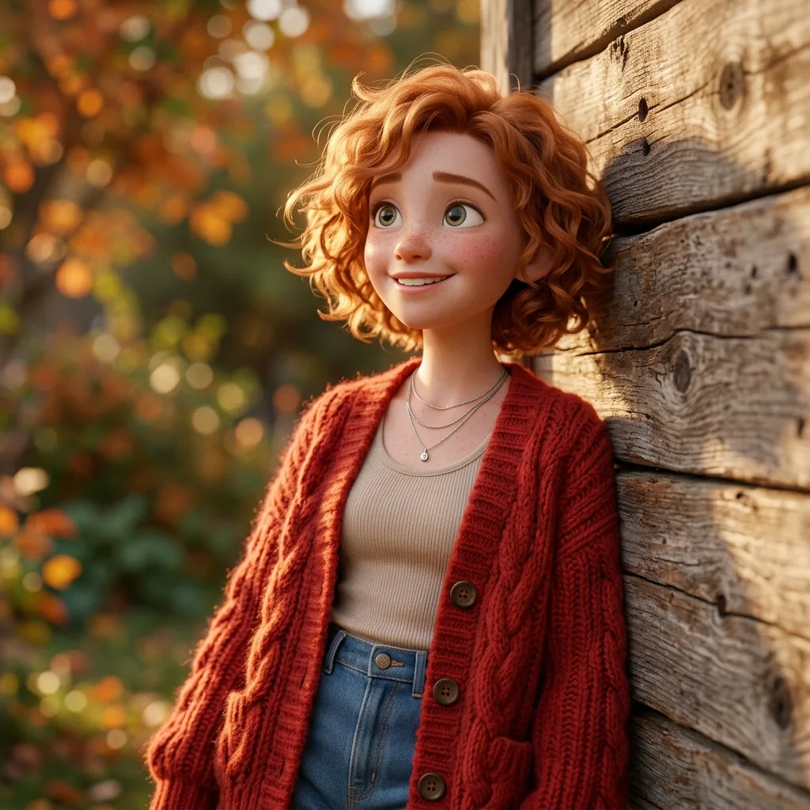

# Stylized 3D animated girl short messy curly ginger hair

[← Back to the collection](../../README.md) · Category: [Illustration & 3D](../../gallery/illustration-3d.md) · Model: `Vinano Image v2` · ID: `vn-00235`

<a href="https://vinano.ai?utm_source=github&utm_medium=readme&utm_campaign=awesome-image-video-prompts-updating&utm_content=prompt-page-image"></a>

<sub>Preview generated with <a href="https://vinano.ai?utm_source=github&utm_medium=readme&utm_campaign=awesome-image-video-prompts-updating&utm_content=prompt-page-caption">vinano.ai</a></sub>

## Prompt

```text
1. A stylized 3D animated girl short messy curly ginger hair, light freckles across her cheeks and nose, soft green eyes, warm friendly smile, wearing an oversized textured red knitted cardigan large buttons, a beige cropped tank top underneath, and high-waisted blue jeans, layered silver necklaces, standing in front of a rustic wooden wall, golden hour warm sunlight casting soft shadows, filmic, cinematic lighting, shallow depth of field, Pixar-style character design, ultra detailed, soft skin shading, premium quality 3D render, warm color palette, cozy autumn vibe.

2. A whimsical 3D animated-style portrait of a young child short, messy, curly brown hair and light freckles, wearing an oversized knitted red cardigan over a simple shirt and denim overalls, leaning gently against a rustic wooden wall. The child is gazing upward a soft, hopeful smile. Warm golden autumn light, shallow depth of field, filmic, cinematic lighting, cozy atmosphere, highly detailed textures, soft skin shading, Pixar-style but original character, ultra high resolution, 85mm lens look, bokeh background, warm color palette, dreamy mood.

Emphasise material texture and natural light so the final frame feels tactile and premium.
```

## Try it on vinano.ai

1. Copy the prompt above.
2. Open **[vinano.ai](https://vinano.ai?utm_source=github&utm_medium=readme&utm_campaign=awesome-image-video-prompts-updating&utm_content=prompt-page-try)**, paste it into the image generator and pick a model.
3. Swap any placeholders (brand, product, city, person…) for your own details, then generate.

More prompts like this: [Illustration & 3D gallery](../../gallery/illustration-3d.md) · [all categories](../../README.md#contents)
