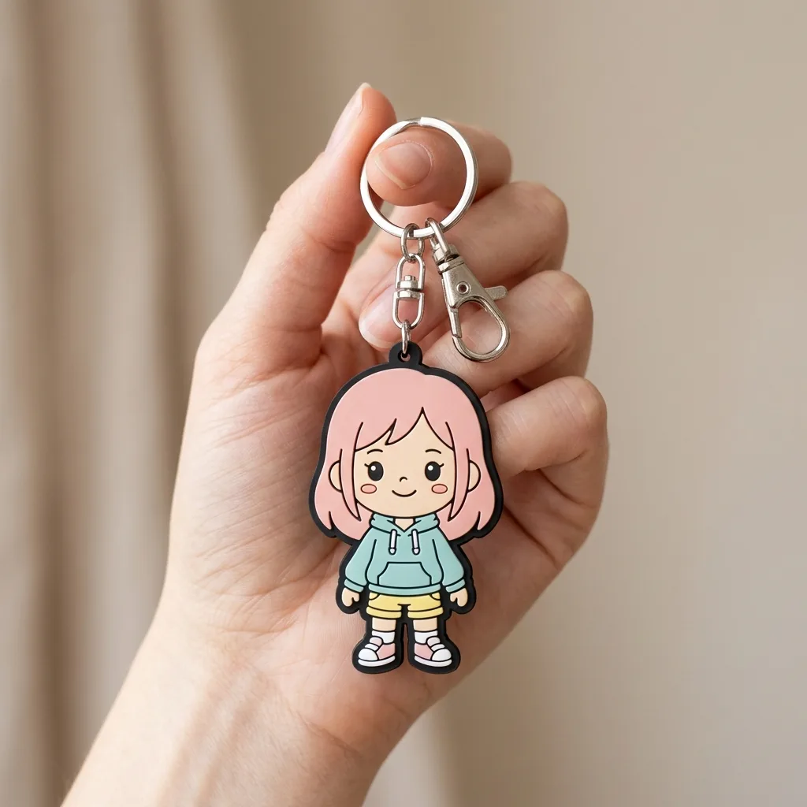

# Close-up photo of a cute, colorful rubber keychain held

[← Back to the collection](../../README.md) · Category: [Illustration & 3D](../../gallery/illustration-3d.md) · Model: `Vinano Image v2` · ID: `vn-00239`

<a href="https://vinano.ai?utm_source=github&utm_medium=readme&utm_campaign=awesome-image-video-prompts-updating&utm_content=prompt-page-image"></a>

<sub>Preview generated with <a href="https://vinano.ai?utm_source=github&utm_medium=readme&utm_campaign=awesome-image-video-prompts-updating&utm_content=prompt-page-caption">vinano.ai</a></sub>

## Prompt

```text
Close-up photo of a cute, colorful rubber keychain held gently in a person’s hand. The keychain features a chibi-style illustration of [character/person], simplified facial features, rounded proportions, soft pastel color palette, bold thick black outlines, smooth matte rubber texture, slightly raised layered detailing, cartoon expression, compact toy-like silhouette. The keychain is attached to a small silver metal clasp and keyring. Natural hand positioning, shallow depth of field, soft diffused lighting, neutral beige background, realistic skin texture, high-detail product photography, 1:1 aspect ratio. Keep edges clean and the overall composition balanced for a polished, gallery-ready result.
```

## Try it on vinano.ai

1. Copy the prompt above.
2. Open **[vinano.ai](https://vinano.ai?utm_source=github&utm_medium=readme&utm_campaign=awesome-image-video-prompts-updating&utm_content=prompt-page-try)**, paste it into the image generator and pick a model.
3. Swap any placeholders (brand, product, city, person…) for your own details, then generate.

More prompts like this: [Illustration & 3D gallery](../../gallery/illustration-3d.md) · [all categories](../../README.md#contents)
