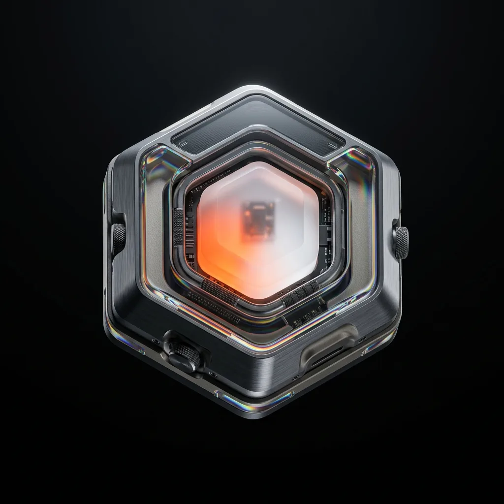

# Illustration & 3D prompt #251

[← Back to the collection](../../README.md) · Category: [Illustration & 3D](../../gallery/illustration-3d.md) · Model: `Vinano Image v2` · ID: `vn-00251`

<a href="https://vinano.ai?utm_source=github&utm_medium=readme&utm_campaign=awesome-image-video-prompts-updating&utm_content=prompt-page-image"></a>

<sub>Preview generated with <a href="https://vinano.ai?utm_source=github&utm_medium=readme&utm_campaign=awesome-image-video-prompts-updating&utm_content=prompt-page-caption">vinano.ai</a></sub>

## Prompt

```text
{
 "image_generation_request": {
 "subject": {
 "placeholder": "[INSERT YOUR PRODUCT HERE]",
 "positioning": "centrally aligned, perfectly centered, levitating in mid-air",
 "framing": "full object visibility, no cropping, no cut-off edges, ample negative space around the product"
 },
 "visual_style": {
 "aesthetic": "ultra-modern industrial design, hyper-realistic product photography, cinematic tech-minimalism",
 "background": {
 "color": "#000000",
 "finish": "pure void, matte black, non-reflective"
 },
 "lighting": {
 "type": "top-down rim lighting, subtle key light",
 "effects": ["spectral dispersion",
 "chromatic aberration on glass edges",
 "prismatic light refraction",
 "soft caustic highlights"]
 }
 },
 "materials_and_textures": {
 "primary_blends": ["anodized brushed aluminum micro-circular grain",
 "frosted translucent polycarbonate internal orange-to-white gradient glow",
 "optically clear glass rainbow refractive edges",
 "matte sandblasted metallic surfaces"],
 "details": "high-precision CNC machined edges, tactile knurling, smooth organic fillets"
 },
 "constraints": {
 "mandatory_omissions": ["no lighting boxes",
 "no softboxes",
 "no tripod stands",
 "no pedestals",
 "no platforms",
 "no props",
 "no text",
 "no watermarks",
 "no human hands",
 "no floor line",
 "no background gradients"],
 "compositional_rules": "The product must be the sole inhabitant of the frame. Ensure zero contact any surface. Maintain absolute symmetry and 100% black levels for the background environment."
 },
 "color_palette": {
 "background": "#000000",
 "accents": ["#FF4500",
 "#FFFFFF",
 "#808080",
 "spectral rainbow/prismatic dispersion"]
 }
 }
}

Render with rich micro-detail while keeping the layout uncluttered and intentional.
```

## Try it on vinano.ai

1. Copy the prompt above.
2. Open **[vinano.ai](https://vinano.ai?utm_source=github&utm_medium=readme&utm_campaign=awesome-image-video-prompts-updating&utm_content=prompt-page-try)**, paste it into the image generator and pick a model.
3. Swap any placeholders (brand, product, city, person…) for your own details, then generate.

More prompts like this: [Illustration & 3D gallery](../../gallery/illustration-3d.md) · [all categories](../../README.md#contents)
