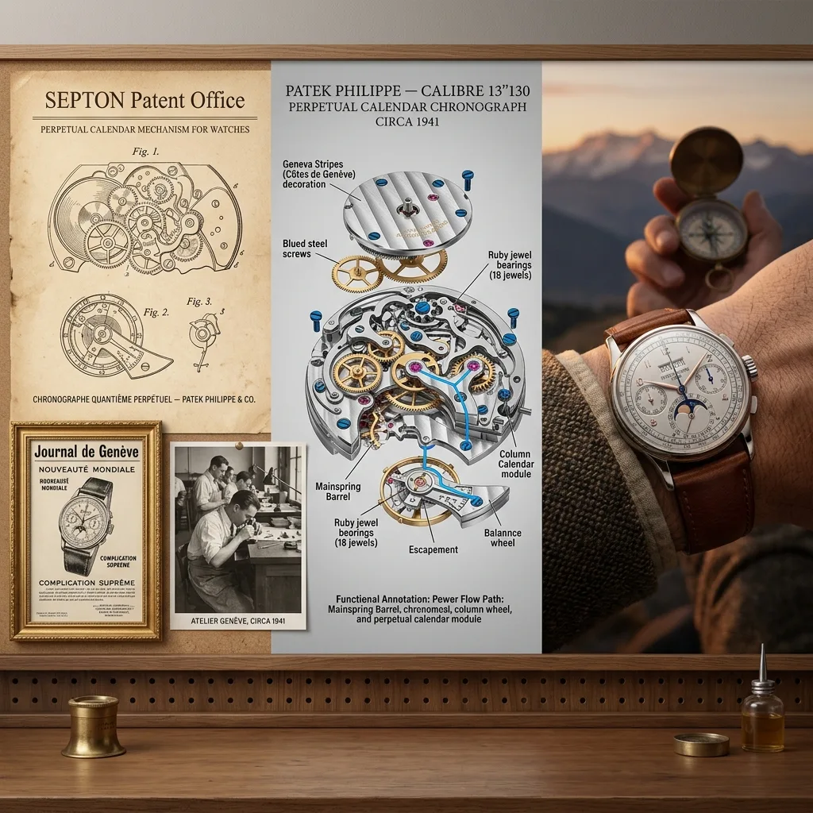

# Master watchmaker's documentation board for TIMEPIECE

[← Back to the collection](../../README.md) · Category: [Illustration & 3D](../../gallery/illustration-3d.md) · Model: `Vinano Image Pro` · ID: `vn-00259`

<a href="https://vinano.ai?utm_source=github&utm_medium=readme&utm_campaign=awesome-image-video-prompts-updating&utm_content=prompt-page-image"></a>

<sub>Preview generated with <a href="https://vinano.ai?utm_source=github&utm_medium=readme&utm_campaign=awesome-image-video-prompts-updating&utm_content=prompt-page-caption">vinano.ai</a></sub>

## Prompt

```text
A master watchmaker's documentation board for [TIMEPIECE] — [MANUFACTURE / COMPLICATION / YEAR]. Left section: historical context showing the original patent drawings, period advertisements in gilded frames, and archival photographs of the atelier craftsmen at work. Center section: the movement in exploded view, every wheel, spring, and jewel suspended in precise spatial relationship, material callouts (Geneva stripes, blued screws, ruby bearings) and functional annotations tracing the flow of power from mainspring to escapement. Right section: the completed watch in its defining context—wrist of an explorer, pocket of a diplomat, or display case of a collector—captured shallow depth and warm side lighting. Visual style transitions from sepia patent office to mechanical precision chrome to intimate portraiture. Title block reading "[WATCH NAME] — CALIBRE [NUMBER], [COMPLICATION], CIRCA [YEAR]". Maintain consistent colour harmony and crisp focus across the whole frame.
```

## Try it on vinano.ai

1. Copy the prompt above.
2. Open **[vinano.ai](https://vinano.ai?utm_source=github&utm_medium=readme&utm_campaign=awesome-image-video-prompts-updating&utm_content=prompt-page-try)**, paste it into the image generator and pick a model.
3. Swap any placeholders (brand, product, city, person…) for your own details, then generate.

More prompts like this: [Illustration & 3D gallery](../../gallery/illustration-3d.md) · [all categories](../../README.md#contents)
