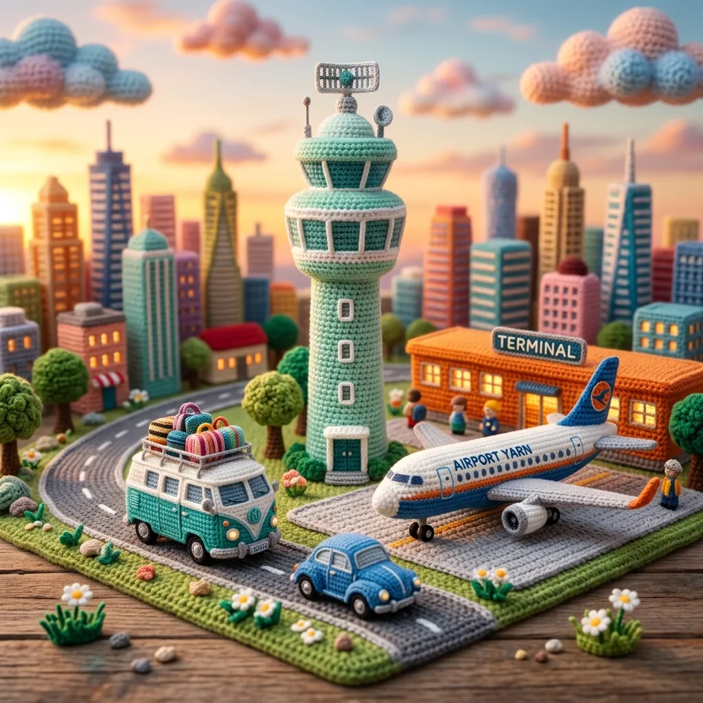

# Highly detailed miniature diorama entirely made of crochet

[← Back to the collection](../../README.md) · Category: [Illustration & 3D](../../gallery/illustration-3d.md) · Model: `Vinano Image Pro` · ID: `vn-00260`

<a href="https://vinano.ai?utm_source=github&utm_medium=readme&utm_campaign=awesome-image-video-prompts-updating&utm_content=prompt-page-image"></a>

<sub>Preview generated with <a href="https://vinano.ai?utm_source=github&utm_medium=readme&utm_campaign=awesome-image-video-prompts-updating&utm_content=prompt-page-caption">vinano.ai</a></sub>

## Prompt

```text
A highly detailed miniature diorama entirely made of crochet and amigurumi yarn, whimsical cute style, featuring a tall mint-green crocheted airport control tower white accents and antenna on top, a small teal crocheted camper van luggage on roof driving on a crocheted road, tiny crocheted blue classic car, a large crocheted passenger airplane parked near an orange-lit terminal building, crocheted city skyline tall buildings in the background, sunset sky soft clouds and golden hour lighting, tiny crocheted daisies and grass patches on the ground, textured yarn stitches visible everywhere, cozy handmade craft aesthetic, soft pastel colors, dreamy warm atmosphere, macro photography style, bokeh background, ultra detailed, cute and charming Preserve realistic proportions and depth for a confident, professional finish.
```

## Try it on vinano.ai

1. Copy the prompt above.
2. Open **[vinano.ai](https://vinano.ai?utm_source=github&utm_medium=readme&utm_campaign=awesome-image-video-prompts-updating&utm_content=prompt-page-try)**, paste it into the image generator and pick a model.
3. Swap any placeholders (brand, product, city, person…) for your own details, then generate.

More prompts like this: [Illustration & 3D gallery](../../gallery/illustration-3d.md) · [all categories](../../README.md#contents)
