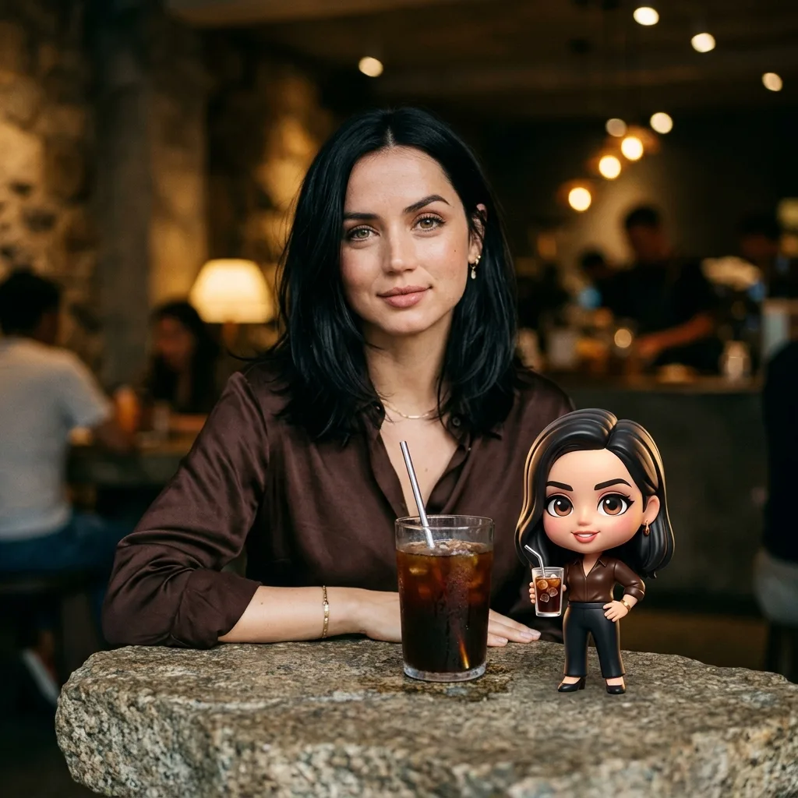

# Ana de Armas

[← Back to the collection](../../README.md) · Category: [Illustration & 3D](../../gallery/illustration-3d.md) · Model: `Vinano Image v2` · ID: `vn-00274`

<a href="https://vinano.ai?utm_source=github&utm_medium=readme&utm_campaign=awesome-image-video-prompts-updating&utm_content=prompt-page-image"></a>

<sub>Preview generated with <a href="https://vinano.ai?utm_source=github&utm_medium=readme&utm_campaign=awesome-image-video-prompts-updating&utm_content=prompt-page-caption">vinano.ai</a></sub>

## Prompt

```text
{
 "aspect_ratio": "1:1",
 "scene_type": "cinematic_studio_portrait",
 "environment": {
 "background_color": "warm_muted_gray",
 "surface": "natural_textured_stone_table",
 "mood": "intimate_evening_cafe",
 "atmosphere": "cozy_moody"
 },
 "primary_subject": {
 "identity": "Ana de Armas",
 "pose": "seated_relaxed",
 "expression": "soft_calm_confident",
 "appearance": {
 "hair": "black_shoulder_length_soft_layers",
 "makeup": "subtle_evening_makeup",
 "outfit": "dark_brown_satin_blouse"
 },
 "focus": "sharp_subject_isolation"
 },
 "props": {
 "main_drink": {
 "type": "cold_brew_coffee",
 "glass": "clear_glass_with_ice",
 "straw": "metal_straw"
 },
 "stylized_figure": {
 "style": "high_quality_3d_chibi_collectible",
 "design": {
 "head": "oversized_rounded",
 "eyes": "large_expressive",
 "cheeks": "soft_blush",
 "features": "simplified_cute"
 },
 "likeness": "same_as_primary_subject",
 "pose": "holding_miniature_cold_brew_glass",
 "material": "glossy_with_soft_reflections"
 }
 },
 "lighting": {
 "type": "soft_cinematic",
 "direction": "angled_key_with_gentle_falloff",
 "highlights": "subtle_reflections_on_glass_and_chibi",
 "shadows": "smooth_and_moody"
 },
 "camera": {
 "depth_of_field": "shallow",
 "focus_priority": "real_subject_then_chibi",
 "look": "cinematic_photography"
 },
 "style_notes": ["realistic_human_combined_with_stylized_3d_character",
 "premium_collectible_toy_aesthetic",
 "warm_color_grading",
 "cozy_evening_tone",
 "ultra_detailed",
 "photoreal_subject"]
}

Emphasise material texture and natural light so the final frame feels tactile and premium.
```

## Try it on vinano.ai

1. Copy the prompt above.
2. Open **[vinano.ai](https://vinano.ai?utm_source=github&utm_medium=readme&utm_campaign=awesome-image-video-prompts-updating&utm_content=prompt-page-try)**, paste it into the image generator and pick a model.
3. Swap any placeholders (brand, product, city, person…) for your own details, then generate.

More prompts like this: [Illustration & 3D gallery](../../gallery/illustration-3d.md) · [all categories](../../README.md#contents)
