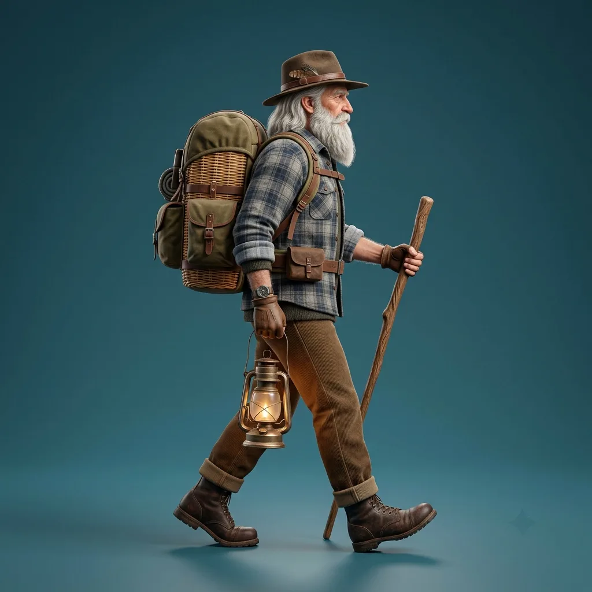

# ​A stylized 3D rendered full-body profile portrait

[← Back to the collection](../../README.md) · Category: [Illustration & 3D](../../gallery/illustration-3d.md) · Model: `Vinano Image v2` · ID: `vn-00275`

<a href="https://vinano.ai?utm_source=github&utm_medium=readme&utm_campaign=awesome-image-video-prompts-updating&utm_content=prompt-page-image"></a>

<sub>Preview generated with <a href="https://vinano.ai?utm_source=github&utm_medium=readme&utm_campaign=awesome-image-video-prompts-updating&utm_content=prompt-page-caption">vinano.ai</a></sub>

## Prompt

```text
​A stylized 3D rendered full-body profile portrait of an elderly male hiker a long white beard, viewed from the side and walking from left to right. He is set against a solid, seamless deep-teal studio background soft floor reflections. He wears a brown felt wide-brimmed hiker's hat, a gray and blue plaid shirt over cuffed brown corduroy trousers, and dark, scuffed work boots. On his back is a large, detailed combination canvas and woven wicker backpack leather straps. He holds a lit, vintage brass-and-glass hurricane lantern in his right hand, which casts a warm, soft glow. He also carries a simple wooden walking stick. The image has a textured, matte finish and soft, diffused studio lighting, the vertical composition leaving ample negative space. Preserve realistic proportions and depth for a confident, professional finish.
```

## Try it on vinano.ai

1. Copy the prompt above.
2. Open **[vinano.ai](https://vinano.ai?utm_source=github&utm_medium=readme&utm_campaign=awesome-image-video-prompts-updating&utm_content=prompt-page-try)**, paste it into the image generator and pick a model.
3. Swap any placeholders (brand, product, city, person…) for your own details, then generate.

More prompts like this: [Illustration & 3D gallery](../../gallery/illustration-3d.md) · [all categories](../../README.md#contents)
