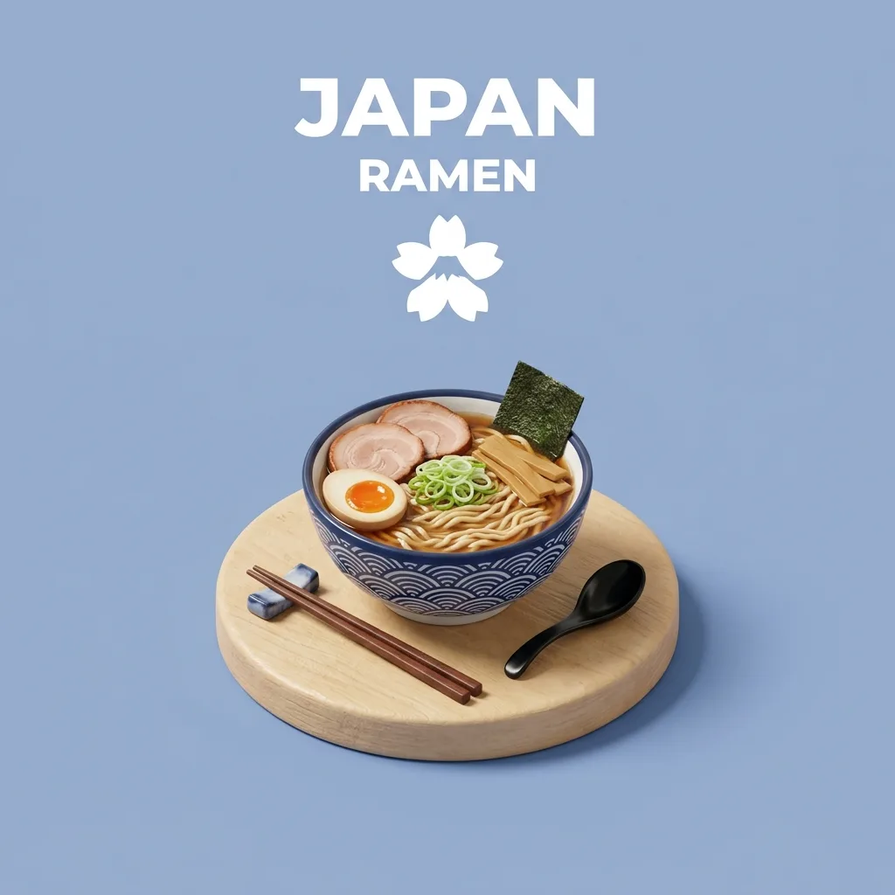

# Present a clear, 45° top-down isometric miniature 3D cartoon

[← Back to the collection](../../README.md) · Category: [Illustration & 3D](../../gallery/illustration-3d.md) · Model: `Vinano Image Pro` · ID: `vn-00276`

<a href="https://vinano.ai?utm_source=github&utm_medium=readme&utm_campaign=awesome-image-video-prompts-updating&utm_content=prompt-page-image"></a>

<sub>Preview generated with <a href="https://vinano.ai?utm_source=github&utm_medium=readme&utm_campaign=awesome-image-video-prompts-updating&utm_content=prompt-page-caption">vinano.ai</a></sub>

## Prompt

```text
Present a clear, 45° top-down isometric miniature 3D cartoon scene of [COUNTRY]’s signature dish: [FOOD], soft refined textures, realistic PBR materials, and gentle lifelike lighting.
Create a small raised diorama-style base showcasing the dish in a highly recognizable presentation, simple complementary elements (plate, table surface, or minimal garnish).
Use a clean solid [COLOR] background.

At the top-center, display [COUNTRY] in large bold text, directly beneath it show [FOOD] in medium text, and place a small simplified national icon or flag below the subtext.
All text must automatically match the background contrast (white or black).

Composition: perfectly centered layout, square 1080x1080, ultra-clean, high-clarity miniature diorama aesthetic.

Aim for an editorial, design-driven look with deliberate negative space.
```

## Try it on vinano.ai

1. Copy the prompt above.
2. Open **[vinano.ai](https://vinano.ai?utm_source=github&utm_medium=readme&utm_campaign=awesome-image-video-prompts-updating&utm_content=prompt-page-try)**, paste it into the image generator and pick a model.
3. Swap any placeholders (brand, product, city, person…) for your own details, then generate.

More prompts like this: [Illustration & 3D gallery](../../gallery/illustration-3d.md) · [all categories](../../README.md#contents)
