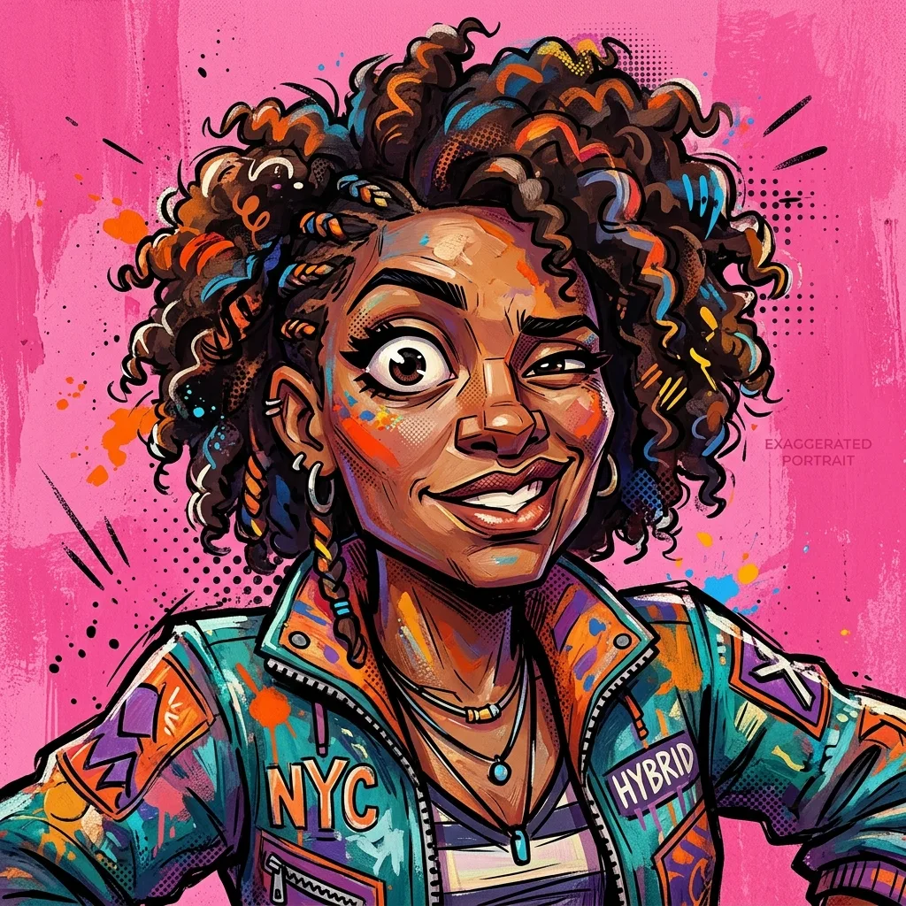

# Painterly exaggerated cartoon portrait combining sculpted 3D anatomy hand-painted

[← Back to the collection](../../README.md) · Category: [Illustration & 3D](../../gallery/illustration-3d.md) · Model: `Vinano Image v2` · ID: `vn-00284`

<a href="https://vinano.ai?utm_source=github&utm_medium=readme&utm_campaign=awesome-image-video-prompts-updating&utm_content=prompt-page-image"></a>

<sub>Preview generated with <a href="https://vinano.ai?utm_source=github&utm_medium=readme&utm_campaign=awesome-image-video-prompts-updating&utm_content=prompt-page-caption">vinano.ai</a></sub>

## Prompt

```text
A painterly exaggerated cartoon portrait combining sculpted 3D anatomy hand-painted illustration textures, spider-verse inspired visual language, distorted facial geometry and expressive asymmetry, intentionally breaking realism while preserving general identity cues such as skin tone and hairstyle, bold line work mixed painted shadows, halftone textures and color splashes graphic animated illustration aesthetic, solid pink studio background, frontal expressive pose, stylized lighting translated into brush-painted highlights, dynamic composition, rich paint texture and high-end hybrid cartoon render. Render with rich micro-detail while keeping the layout uncluttered and intentional.
```

## Try it on vinano.ai

1. Copy the prompt above.
2. Open **[vinano.ai](https://vinano.ai?utm_source=github&utm_medium=readme&utm_campaign=awesome-image-video-prompts-updating&utm_content=prompt-page-try)**, paste it into the image generator and pick a model.
3. Swap any placeholders (brand, product, city, person…) for your own details, then generate.

More prompts like this: [Illustration & 3D gallery](../../gallery/illustration-3d.md) · [all categories](../../README.md#contents)
