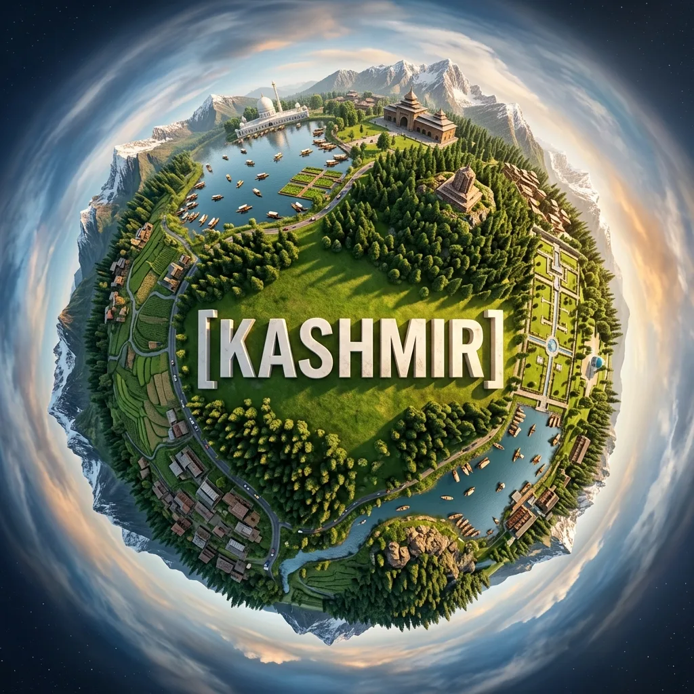

# Miniature planet showcasing KASHMIR famous landmarks seamlessly curving around

[← Back to the collection](../../README.md) · Category: [Illustration & 3D](../../gallery/illustration-3d.md) · Model: `Vinano Image v2` · ID: `vn-00288`

<a href="https://vinano.ai?utm_source=github&utm_medium=readme&utm_campaign=awesome-image-video-prompts-updating&utm_content=prompt-page-image"></a>

<sub>Preview generated with <a href="https://vinano.ai?utm_source=github&utm_medium=readme&utm_campaign=awesome-image-video-prompts-updating&utm_content=prompt-page-caption">vinano.ai</a></sub>

## Prompt

```text
Create a hyper-realistic miniature planet showcasing [KASHMIR] famous landmarks seamlessly curving around the spherical surface. Position bold 3D white text “[KASHMIR]” naturally integrated across the lush green central parkland realistic shadows and dimensional depth. Capture from a top-down orbiting angle that emphasizes the dramatic planet curvature. Use soft golden hour daylight filtering through partly cloudy skies, casting gentle shadows on emerald grass and surrounding trees. The background should blend into a swirling atmospheric sky. Apply vibrant greens, warm earth tones, and soft blues. Render in polished true-to-life photorealistic style fine architectural detail. 1080x1080 format. Emphasise material texture and natural light so the final frame feels tactile and premium.
```

## Try it on vinano.ai

1. Copy the prompt above.
2. Open **[vinano.ai](https://vinano.ai?utm_source=github&utm_medium=readme&utm_campaign=awesome-image-video-prompts-updating&utm_content=prompt-page-try)**, paste it into the image generator and pick a model.
3. Swap any placeholders (brand, product, city, person…) for your own details, then generate.

More prompts like this: [Illustration & 3D gallery](../../gallery/illustration-3d.md) · [all categories](../../README.md#contents)
