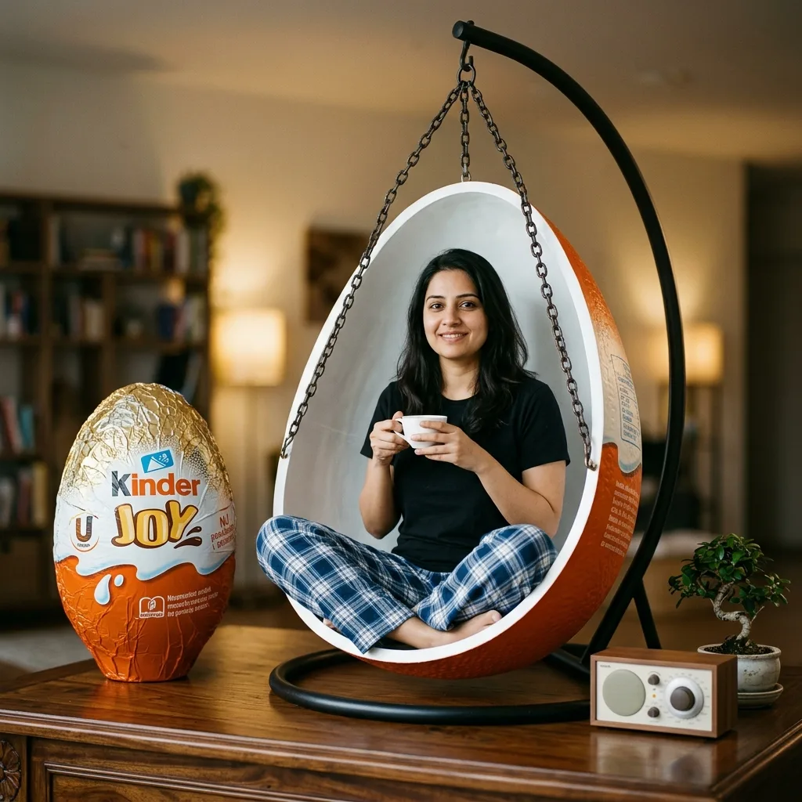

# 8k, medium shot photograph captured a standard lens

[← Back to the collection](../../README.md) · Category: [Illustration & 3D](../../gallery/illustration-3d.md) · Model: `Vinano Image v2` · ID: `vn-00291`

<a href="https://vinano.ai?utm_source=github&utm_medium=readme&utm_campaign=awesome-image-video-prompts-updating&utm_content=prompt-page-image"></a>

<sub>Preview generated with <a href="https://vinano.ai?utm_source=github&utm_medium=readme&utm_campaign=awesome-image-video-prompts-updating&utm_content=prompt-page-caption">vinano.ai</a></sub>

## Prompt

```text
A hyper-realistic, 8k, medium shot photograph captured a standard lens and shallow depth of field, showcasing a surreal indoor scene filmic, cinematic lighting. The composition features a normal-sized woman, the uploaded face as reference, sitting cross-legged inside a colossal, highly detailed Kinder Joy egg that functions as a swing chair. The giant egg is split, its white interior forming the seat and the orange, textured exterior visible, suspended by dark metal chains from a curved, dark metal stand.

The woman wears a black t-shirt and blue and white plaid pajama pants, holding a small white teacup both hands, looking directly at the viewer a calm and relaxed expression.

To the left in the foreground, on a highly detailed polished wooden table, stands another gigantic, fully wrapped Kinder Joy egg, exhibiting intricate foil texture and branding. To the right of the swing's base, also on the table, are miniature props: a vintage-style wooden radio white dials and a tiny bonsai tree in a small pot.

The lighting is soft, warm, and directional from the left, casting subtle shadows and highlighting the highly detailed textures of the egg wrappers, the woman’s clothing, and the wooden surface. The background is a softly blurred, warm-toned interior wall, creating a pleasing bokeh effect.

Preserve realistic proportions and depth for a confident, professional finish.
```

## Try it on vinano.ai

1. Copy the prompt above.
2. Open **[vinano.ai](https://vinano.ai?utm_source=github&utm_medium=readme&utm_campaign=awesome-image-video-prompts-updating&utm_content=prompt-page-try)**, paste it into the image generator and pick a model.
3. Swap any placeholders (brand, product, city, person…) for your own details, then generate.

More prompts like this: [Illustration & 3D gallery](../../gallery/illustration-3d.md) · [all categories](../../README.md#contents)
