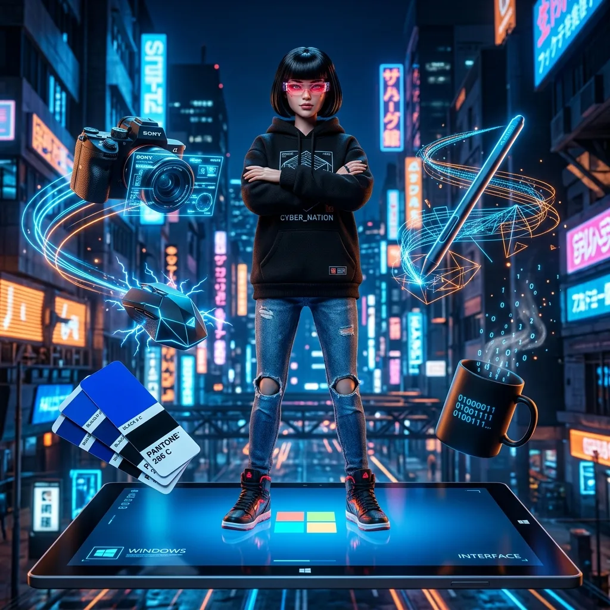

# Full-body portrait of a woman, the exact pose

[← Back to the collection](../../README.md) · Category: [Illustration & 3D](../../gallery/illustration-3d.md) · Model: `Vinano Image v2` · ID: `vn-00292`

<a href="https://vinano.ai?utm_source=github&utm_medium=readme&utm_campaign=awesome-image-video-prompts-updating&utm_content=prompt-page-image"></a>

<sub>Preview generated with <a href="https://vinano.ai?utm_source=github&utm_medium=readme&utm_campaign=awesome-image-video-prompts-updating&utm_content=prompt-page-caption">vinano.ai</a></sub>

## Prompt

```text
Hyper-realistic full-body portrait of a woman, the exact pose from the uploaded photo, transformed into a stylish female doll. she stands confidently arms crossed on a giant Microsoft Surface Tablet as a platform, wearing urban streetwear (black hoodie, jeans, sneakers) and sleek red tech glasses.

Surrounding him in a dynamic, floating arrangement are masculine graphic design tools: a futuristic camera blue holographic glow, a geometric computer mouse electric sparks, a digital pen creating digital wireframe trails, a floating Pantone swatch book in bold blue and black colors, and a refined minimalist black coffee mug binary code steam.

The scene features a vibrant blue and orange color scheme dynamic lighting. Cyberpunk aesthetic, neon accents, particle effects. Style is a blend of 3D animation and tech photography. Sharp focus, filmic, cinematic lighting, 8k resolution.

Maintain consistent colour harmony and crisp focus across the whole frame.
```

## Try it on vinano.ai

1. Copy the prompt above.
2. Open **[vinano.ai](https://vinano.ai?utm_source=github&utm_medium=readme&utm_campaign=awesome-image-video-prompts-updating&utm_content=prompt-page-try)**, paste it into the image generator and pick a model.
3. Swap any placeholders (brand, product, city, person…) for your own details, then generate.

More prompts like this: [Illustration & 3D gallery](../../gallery/illustration-3d.md) · [all categories](../../README.md#contents)
