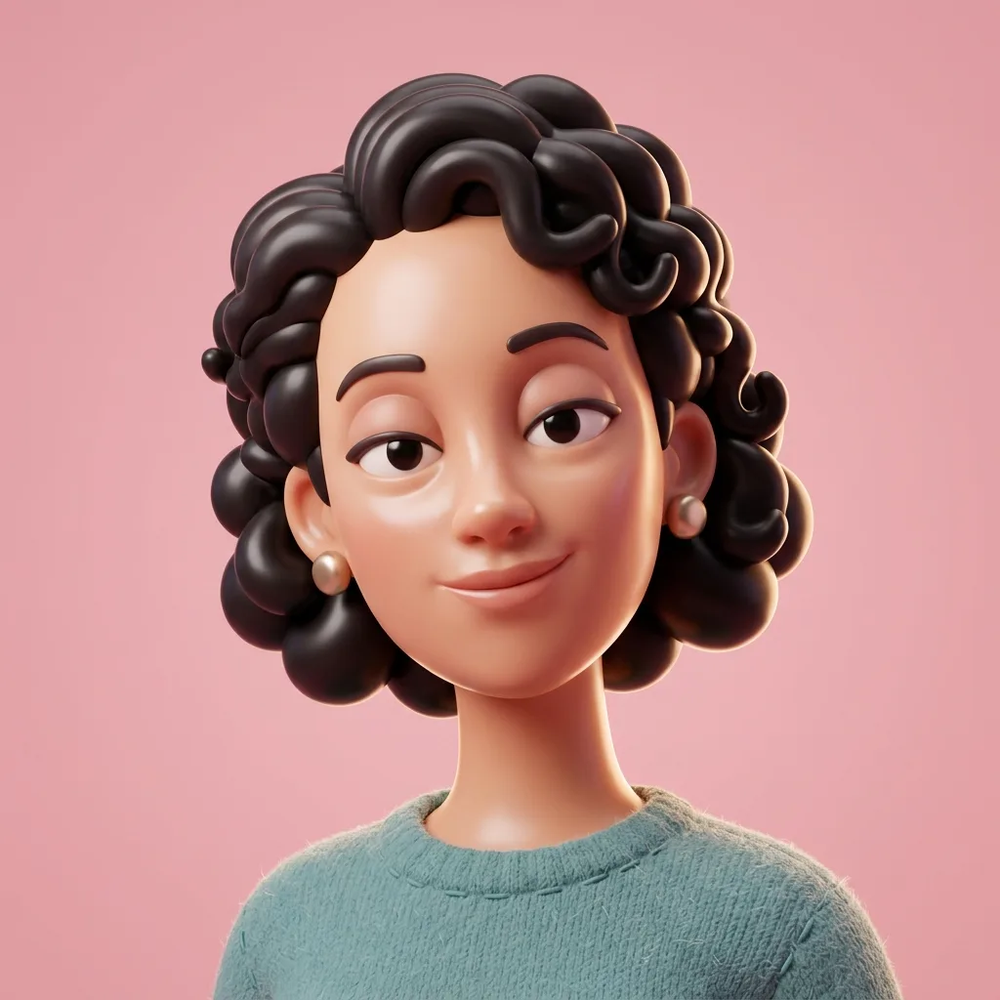

# Transform the person from the attached photo into

[← Back to the collection](../../README.md) · Category: [Illustration & 3D](../../gallery/illustration-3d.md) · Model: `Vinano Image v2` · ID: `vn-00297`

<a href="https://vinano.ai?utm_source=github&utm_medium=readme&utm_campaign=awesome-image-video-prompts-updating&utm_content=prompt-page-image"></a>

<sub>Preview generated with <a href="https://vinano.ai?utm_source=github&utm_medium=readme&utm_campaign=awesome-image-video-prompts-updating&utm_content=prompt-page-caption">vinano.ai</a></sub>

## Prompt

```text
Transform the person from the attached photo into a smooth stylized 3D cartoon character in the same style as the reference. Keep all real facial features fully recognizable but translated into exaggerated proportions (elongated head, big eyelids, soft rounded shapes). Skin should look glossy and plastic-like clean gradients and subtle highlights. Use soft studio lighting, a solid [COLOR] color background, and high-end Pixar- inspired rendering. Simplify details, add gentle rim light, and preserve the person's hairstyle and accessories in stylized form. The final look must match the clean polished 3D aesthetic of the reference, 4:5 dimension. Emphasise material texture and natural light so the final frame feels tactile and premium.
```

## Try it on vinano.ai

1. Copy the prompt above.
2. Open **[vinano.ai](https://vinano.ai?utm_source=github&utm_medium=readme&utm_campaign=awesome-image-video-prompts-updating&utm_content=prompt-page-try)**, paste it into the image generator and pick a model.
3. Swap any placeholders (brand, product, city, person…) for your own details, then generate.

More prompts like this: [Illustration & 3D gallery](../../gallery/illustration-3d.md) · [all categories](../../README.md#contents)
