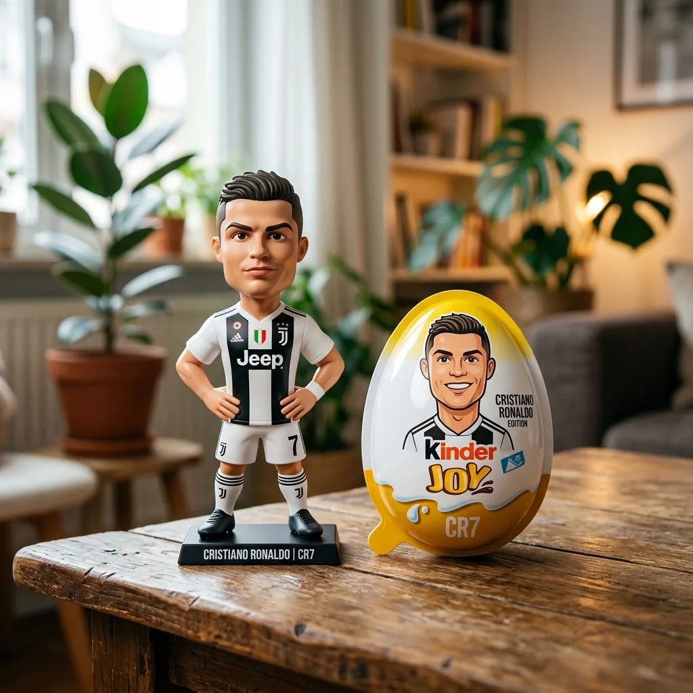

# Cute stylized 3D collectible figurine inspired by Cristiano Ronaldo

[← Back to the collection](../../README.md) · Category: [Illustration & 3D](../../gallery/illustration-3d.md) · Model: `Vinano Image v2` · ID: `vn-00309`

<a href="https://vinano.ai?utm_source=github&utm_medium=readme&utm_campaign=awesome-image-video-prompts-updating&utm_content=prompt-page-image"></a>

<sub>Preview generated with <a href="https://vinano.ai?utm_source=github&utm_medium=readme&utm_campaign=awesome-image-video-prompts-updating&utm_content=prompt-page-caption">vinano.ai</a></sub>

## Prompt

```text
A cute stylized 3D collectible figurine inspired by Cristiano Ronaldo, short styled hair and an athletic build, wearing a modern football kit and standing confidently hands on hips. Next to him is a large Kinder Joy egg featuring a cartoon avatar of the same football star printed on the shell. The scene is placed on a wooden table soft natural lighting, shallow depth of field, cozy indoor background blurred plants, highly detailed Pixar-style 3D render, glossy toy texture, filmic, cinematic lighting, ultra-detailed product photography, designer toy aesthetic. ⚽🥚 Preserve realistic proportions and depth for a confident, professional finish.
```

## Try it on vinano.ai

1. Copy the prompt above.
2. Open **[vinano.ai](https://vinano.ai?utm_source=github&utm_medium=readme&utm_campaign=awesome-image-video-prompts-updating&utm_content=prompt-page-try)**, paste it into the image generator and pick a model.
3. Swap any placeholders (brand, product, city, person…) for your own details, then generate.

More prompts like this: [Illustration & 3D gallery](../../gallery/illustration-3d.md) · [all categories](../../README.md#contents)
