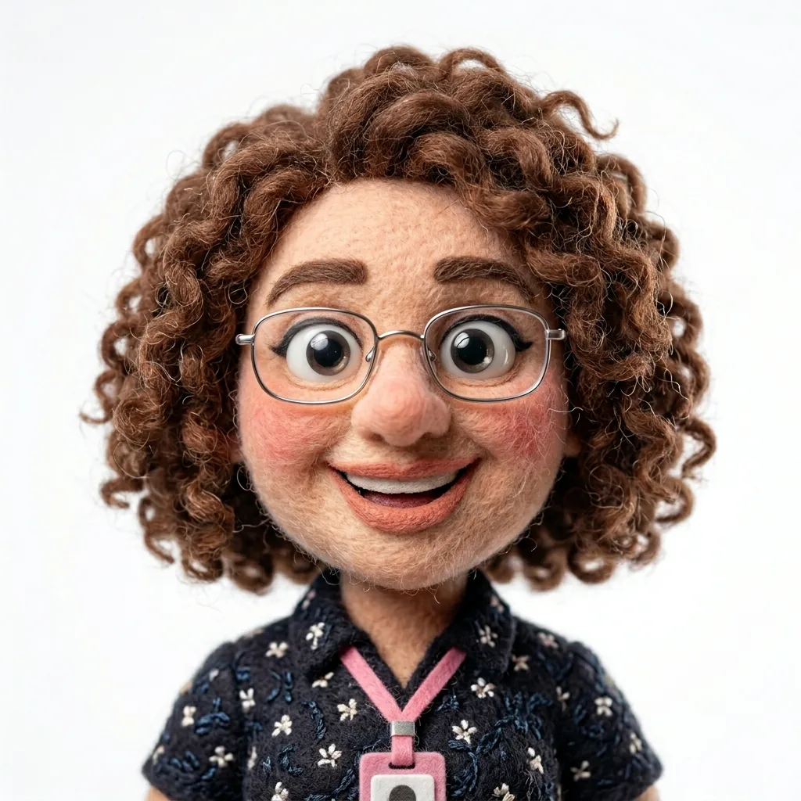

# Transform the uploaded image into a stylized 3D claymation

[← Back to the collection](../../README.md) · Category: [Illustration & 3D](../../gallery/illustration-3d.md) · Model: `Vinano Image v2` · ID: `vn-00320`

<a href="https://vinano.ai?utm_source=github&utm_medium=readme&utm_campaign=awesome-image-video-prompts-updating&utm_content=prompt-page-image"></a>

<sub>Preview generated with <a href="https://vinano.ai?utm_source=github&utm_medium=readme&utm_campaign=awesome-image-video-prompts-updating&utm_content=prompt-page-caption">vinano.ai</a></sub>

## Prompt

```text
Transform the uploaded image into a stylized 3D claymation character. Soft felt / fuzzy texture skin, rounded exaggerated facial features, big expressive eyes, thick soft eyebrows, slightly oversized nose, warm blush tones on cheeks. Playful open-mouth expression. Clean pure white studio background. Soft diffused studio lighting, subtle rim light, shallow depth of field. Pixar-style charm, stop-motion aesthetic, highly detailed fibers and soft materials, cinematic render, warm vibrant tones. Preserve realistic proportions and depth for a confident, professional finish.
```

## Try it on vinano.ai

1. Copy the prompt above.
2. Open **[vinano.ai](https://vinano.ai?utm_source=github&utm_medium=readme&utm_campaign=awesome-image-video-prompts-updating&utm_content=prompt-page-try)**, paste it into the image generator and pick a model.
3. Swap any placeholders (brand, product, city, person…) for your own details, then generate.

More prompts like this: [Illustration & 3D gallery](../../gallery/illustration-3d.md) · [all categories](../../README.md#contents)
