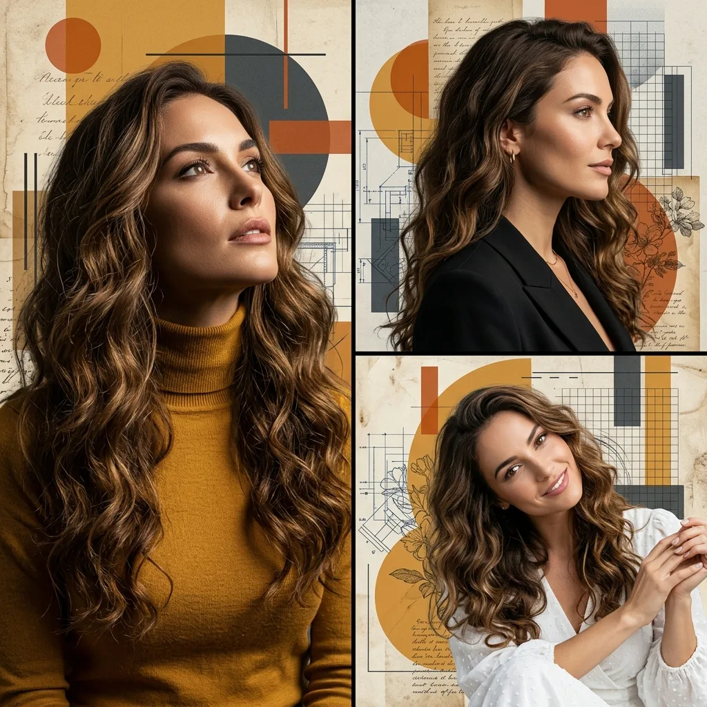

# High-resolution, true-to-life photorealistic three-panel composition featuring a woman long

[← Back to the collection](../../README.md) · Category: [Illustration & 3D](../../gallery/illustration-3d.md) · Model: `Vinano Image Pro` · ID: `vn-00322`

<a href="https://vinano.ai?utm_source=github&utm_medium=readme&utm_campaign=awesome-image-video-prompts-updating&utm_content=prompt-page-image"></a>

<sub>Preview generated with <a href="https://vinano.ai?utm_source=github&utm_medium=readme&utm_campaign=awesome-image-video-prompts-updating&utm_content=prompt-page-caption">vinano.ai</a></sub>

## Prompt

```text
A high-resolution, true-to-life photorealistic three-panel composition featuring a woman long, voluminous wavy brown hair and elegant features, integrated into an abstract mixed-media collage background.
Panel Layout:

Left Panel (Vertical, full height):

A tall portrait of the woman looking upwards at a dramatic angle, wearing a mustard yellow turtleneck. filmic, cinematic lighting highlights her face and hair, strong shadows and depth.
Top Right Panel (Square):

A close-up angled side profile, soft gaze to the right, wearing a black modern blazer minimal jewelry. Expression is calm and confident.
Bottom Right Panel (Square):

A slightly top-down perspective, playful yet elegant pose, wearing a white textured dress, subtle smile, natural lighting.
Art Style & Background (applies to all panels):

The image is layered an abstract mixed-media collage background incorporating geometric shapes like circles and rectangles in ochre, burnt orange, and charcoal grey. Include textural elements such as vintage parchment paper, blueprint-style technical sketches, and subtle floral etchings. Use a flat graphic design overlay that partially blends into each outfit, seamlessly merging the 3D subject 2D modernist art.
Overall Style:

filmic, cinematic lighting, fine art photography aesthetic, ultra-detailed, 8K resolution, modern editorial fashion magazine layout.

Keep edges clean and the overall composition balanced for a polished, gallery-ready result.
```

## Try it on vinano.ai

1. Copy the prompt above.
2. Open **[vinano.ai](https://vinano.ai?utm_source=github&utm_medium=readme&utm_campaign=awesome-image-video-prompts-updating&utm_content=prompt-page-try)**, paste it into the image generator and pick a model.
3. Swap any placeholders (brand, product, city, person…) for your own details, then generate.

More prompts like this: [Illustration & 3D gallery](../../gallery/illustration-3d.md) · [all categories](../../README.md#contents)
