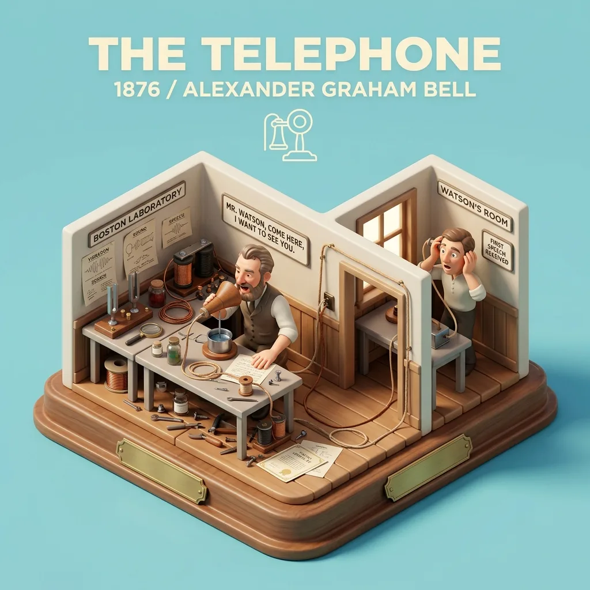

# Miniature 3D isometric diorama showing the invention of INVENTION

[← Back to the collection](../../README.md) · Category: [Illustration & 3D](../../gallery/illustration-3d.md) · Model: `Vinano Image Pro` · ID: `vn-00327`

<a href="https://vinano.ai?utm_source=github&utm_medium=readme&utm_campaign=awesome-image-video-prompts-updating&utm_content=prompt-page-image"></a>

<sub>Preview generated with <a href="https://vinano.ai?utm_source=github&utm_medium=readme&utm_campaign=awesome-image-video-prompts-updating&utm_content=prompt-page-caption">vinano.ai</a></sub>

## Prompt

```text
Create a miniature 3D isometric diorama showing the invention of [INVENTION NAME] at the moment of [KEY BREAKTHROUGH].

Camera angle around 40° from above.
Textures feel soft and polished. Materials follow realistic PBR rules. Lighting feels natural and balanced.

The raised base includes tools, workshop elements, notes, and early prototypes. Tiny stylized inventors interact objects. Faces are visible and recognizable clean shapes and expressions.

Background stays solid [BACKGROUND COLOR].
Top center text shows [INVENTION NAME] in bold.
Second line shows [YEAR OR INVENTOR].
A simple line icon of the invention sits below.
Text color adapts to background contrast.

Emphasise material texture and natural light so the final frame feels tactile and premium.
```

## Try it on vinano.ai

1. Copy the prompt above.
2. Open **[vinano.ai](https://vinano.ai?utm_source=github&utm_medium=readme&utm_campaign=awesome-image-video-prompts-updating&utm_content=prompt-page-try)**, paste it into the image generator and pick a model.
3. Swap any placeholders (brand, product, city, person…) for your own details, then generate.

More prompts like this: [Illustration & 3D gallery](../../gallery/illustration-3d.md) · [all categories](../../README.md#contents)
