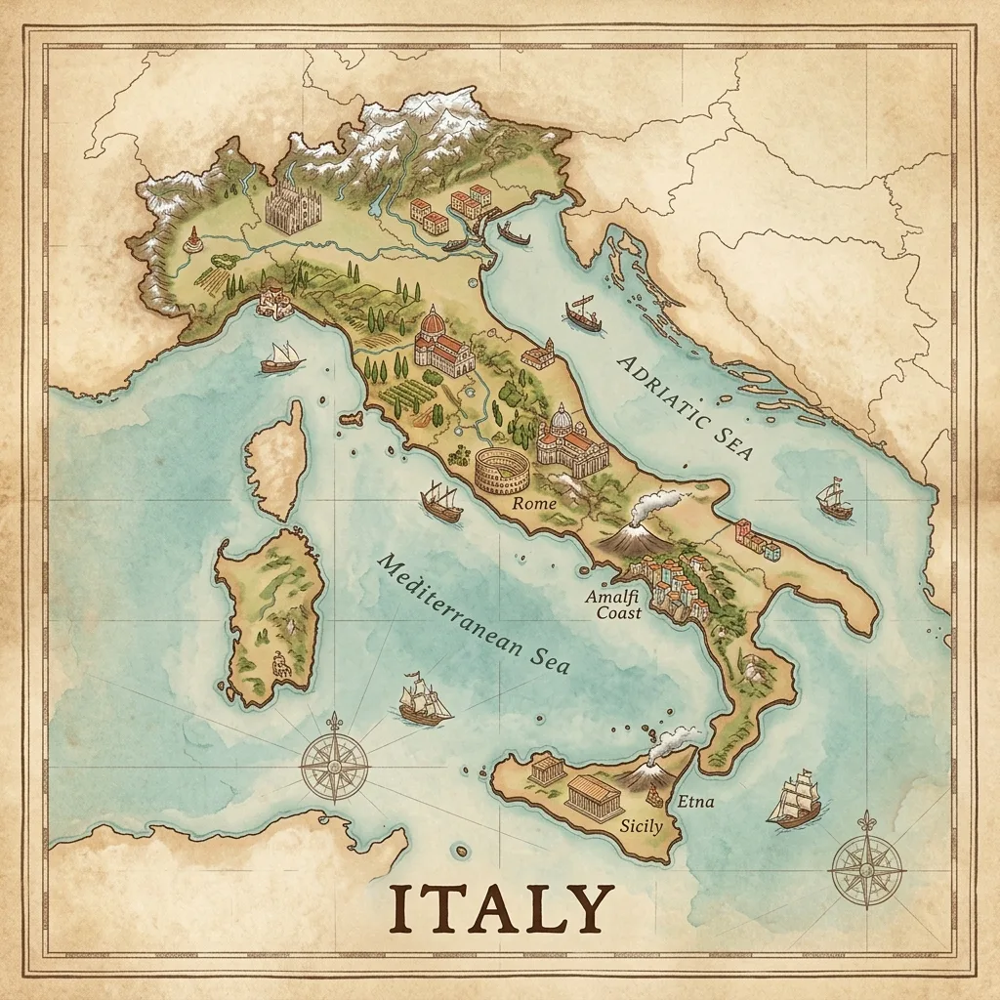

# Hand-painted isometric bird’s-eye view illustration of COUNTRY

[← Back to the collection](../../README.md) · Category: [Illustration & 3D](../../gallery/illustration-3d.md) · Model: `Vinano Image Pro` · ID: `vn-00334`

<a href="https://vinano.ai?utm_source=github&utm_medium=readme&utm_campaign=awesome-image-video-prompts-updating&utm_content=prompt-page-image"></a>

<sub>Preview generated with <a href="https://vinano.ai?utm_source=github&utm_medium=readme&utm_campaign=awesome-image-video-prompts-updating&utm_content=prompt-page-caption">vinano.ai</a></sub>

## Prompt

```text
A hand-painted isometric bird’s-eye view illustration of [COUNTRY] in a vintage map style, featuring iconic landmarks and natural scenery unique to the country. The landscape should blend seamlessly a parchment-colored map background, and include detailed miniature architecture, cultural symbols, and geographical elements. The country name '[COUNTRY]' should appear in bold serif text below the scene. Maintain warm, earthy tones and soft, diffused lighting for a classic, illustrated map feel. 1080x1080 dimension Render with rich micro-detail while keeping the layout uncluttered and intentional.
```

## Try it on vinano.ai

1. Copy the prompt above.
2. Open **[vinano.ai](https://vinano.ai?utm_source=github&utm_medium=readme&utm_campaign=awesome-image-video-prompts-updating&utm_content=prompt-page-try)**, paste it into the image generator and pick a model.
3. Swap any placeholders (brand, product, city, person…) for your own details, then generate.

More prompts like this: [Illustration & 3D gallery](../../gallery/illustration-3d.md) · [all categories](../../README.md#contents)
