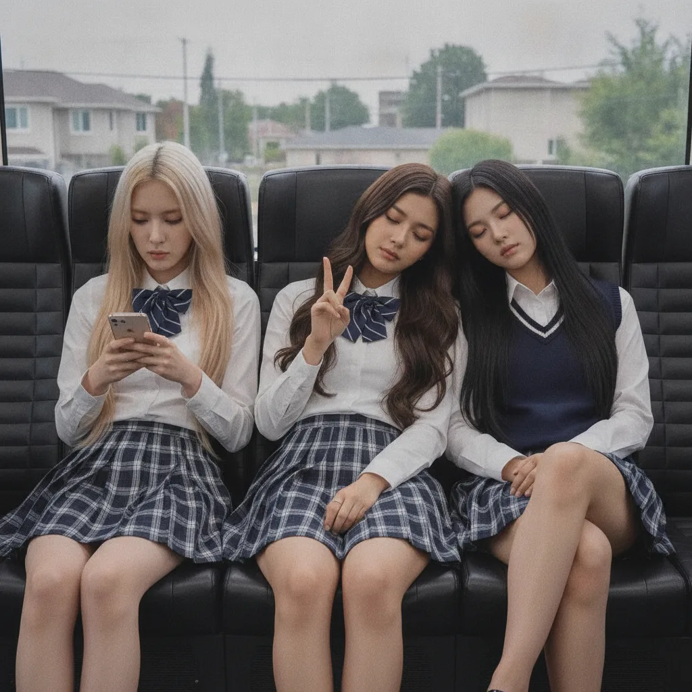

# Slender face, pale skin, long straight blonde hair, soft

[← Back to the collection](../../README.md) · Category: [Illustration & 3D](../../gallery/illustration-3d.md) · Model: `Vinano Image` · ID: `vn-00335`

<a href="https://vinano.ai?utm_source=github&utm_medium=readme&utm_campaign=awesome-image-video-prompts-updating&utm_content=prompt-page-image"></a>

<sub>Preview generated with <a href="https://vinano.ai?utm_source=github&utm_medium=readme&utm_campaign=awesome-image-video-prompts-updating&utm_content=prompt-page-caption">vinano.ai</a></sub>

## Prompt

```text
{
"prompt": "Three K-pop idols sitting on a train. Left girl is Rosé pale skin and long blonde hair, looking at a phone. Middle girl is Tzuyu warm fair skin and dark brown hair, sleeping, making a peace sign. Right girl is Karina sharp facial features and long dark hair, sleeping, wearing a navy vest. Uniforms: white shirts, navy plaid skirts, bow ties. Train window background. --ar 3:4",
"aspect_ratio": "3:4",
"subjects": [{
"position": "left",
"identity": "Rosé",
"physical_characteristics": "slender face, pale skin, long straight blonde hair, soft monolid eyes, petite build",
"pose": "looking down, holding phone",
"outfit": "white cotton long-sleeve shirt, navy/white plaid pleated skirt, navy striped bow tie",
"items": "smartphone"
},
{
"position": "middle",
"identity": "Tzuyu",
"physical_characteristics": "elegant features, warm fair skin, large doe eyes, long dark brown wavy hair, tall build",
"pose": "head tilted left, eyes closed, right hand making peace sign",
"outfit": "white cotton long-sleeve shirt, navy/white plaid pleated skirt, navy striped bow tie"
},
{
"position": "right",
"identity": "Karina",
"physical_characteristics": "sharp V-line jaw, small face, fair skin, long straight dark black hair, AI-like flawless features",
"pose": "head tilted right, eyes closed, resting, legs crossed",
"outfit": "white cotton shirt, navy knit vest, navy/white plaid pleated skirt, navy striped bow tie, black patent leather loafers"
}],
"background": {
"setting": "Train interior",
"details": "Black ribbed seat, window showing daytime suburban houses and power lines."
},
"color_grading": {
"style": "Natural daylight, slightly muted, soft contrast",
"lighting": "Backlit from window, diffuse interior fill"
},
"color_palette": {
"navy_blue": "#1C2841",
"white": "#F0F0F0",
"plaid_grey": "#5A6A7A",
"skin_tone_pale": "#F3E3D3",
"skin_tone_warm": "#EACCA9",
"hair_blonde": "#E8D3A2",
"hair_dark": "#1A1A1A",
"shoe_black": "#050505"
}
}

Maintain consistent colour harmony and crisp focus across the whole frame.
```

## Try it on vinano.ai

1. Copy the prompt above.
2. Open **[vinano.ai](https://vinano.ai?utm_source=github&utm_medium=readme&utm_campaign=awesome-image-video-prompts-updating&utm_content=prompt-page-try)**, paste it into the image generator and pick a model.
3. Swap any placeholders (brand, product, city, person…) for your own details, then generate.

More prompts like this: [Illustration & 3D gallery](../../gallery/illustration-3d.md) · [all categories](../../README.md#contents)
