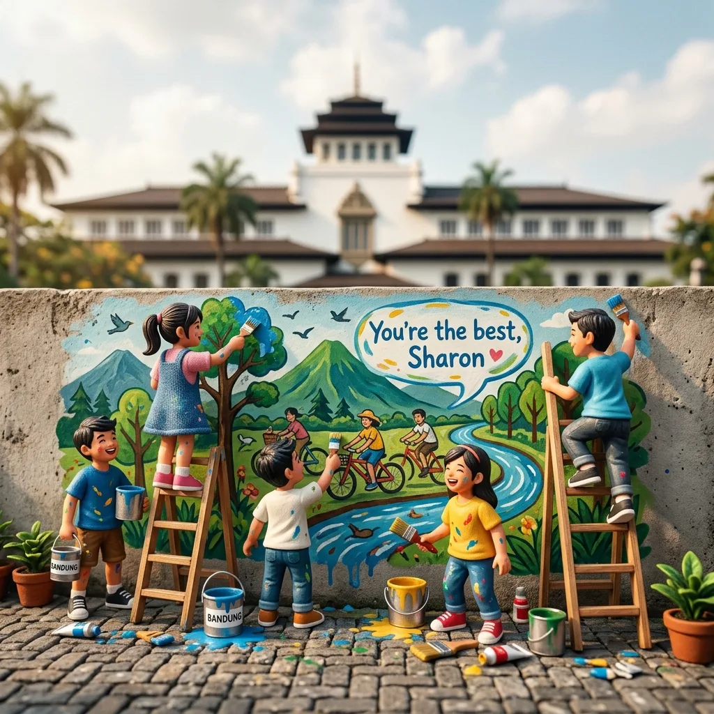

# Miniature youth figurines

[← Back to the collection](../../README.md) · Category: [Illustration & 3D](../../gallery/illustration-3d.md) · Model: `Vinano Image Pro` · ID: `vn-00340`

<a href="https://vinano.ai?utm_source=github&utm_medium=readme&utm_campaign=awesome-image-video-prompts-updating&utm_content=prompt-page-image"></a>

<sub>Preview generated with <a href="https://vinano.ai?utm_source=github&utm_medium=readme&utm_campaign=awesome-image-video-prompts-updating&utm_content=prompt-page-caption">vinano.ai</a></sub>

## Prompt

```text
{
 "scene": {
 "description": "Artistic miniature diorama of youthful figurines collaboratively painting a vibrant environmental mural on a small outdoor wall near Gedung Sate, Bandung.",
 "location": "Near Gedung Sate, Bandung, Indonesia",
 "environment": "Urban cultural landmark setting a cozy, handcrafted miniature scale"
 },
 "subjects": {
 "characters": "Miniature youth figurines",
 "actions": ["painting a large colorful mural",
 "climbing tiny ladders",
 "holding paint brushes and buckets",
 "splashing paint playfully"],
 "expressions": "Energetic, joyful, creative"
 },
 "mural_details": {
 "theme": "Environmental awareness and positivity",
 "elements": ["green mountains",
 "lush trees",
 "bicycles symbolizing eco-friendly transport",
 "clean flowing rivers"],
 "text": "You're the best, Sharon"
 },
 "props": {
 "items": ["tiny paint buckets",
 "mini ladders",
 "small paint brushes",
 "paint splashes on ground and wall"]
 },
 "style": {
 "art_form": "Miniature diorama",
 "photography": "Cinematic macro photography",
 "detail_level": "Highly detailed textures and figures"
 },
 "lighting": {
 "type": "Warm, soft, diffused lighting",
 "mood": "Bright, cheerful, uplifting"
 },
 "camera": {
 "depth_of_field": "Shallow depth of field",
 "focus": "Sharp focus on figurines and mural"
 },
 "color_palette": {
 "tones": ["Bright",
 "Cheerful",
 "Vivid"]
 },
 "render_settings": {
 "aspect_ratio": "4:5",
 "quality": 2,
 "stylization": "2/5"
 }
}

Emphasise material texture and natural light so the final frame feels tactile and premium.
```

## Try it on vinano.ai

1. Copy the prompt above.
2. Open **[vinano.ai](https://vinano.ai?utm_source=github&utm_medium=readme&utm_campaign=awesome-image-video-prompts-updating&utm_content=prompt-page-try)**, paste it into the image generator and pick a model.
3. Swap any placeholders (brand, product, city, person…) for your own details, then generate.

More prompts like this: [Illustration & 3D gallery](../../gallery/illustration-3d.md) · [all categories](../../README.md#contents)
