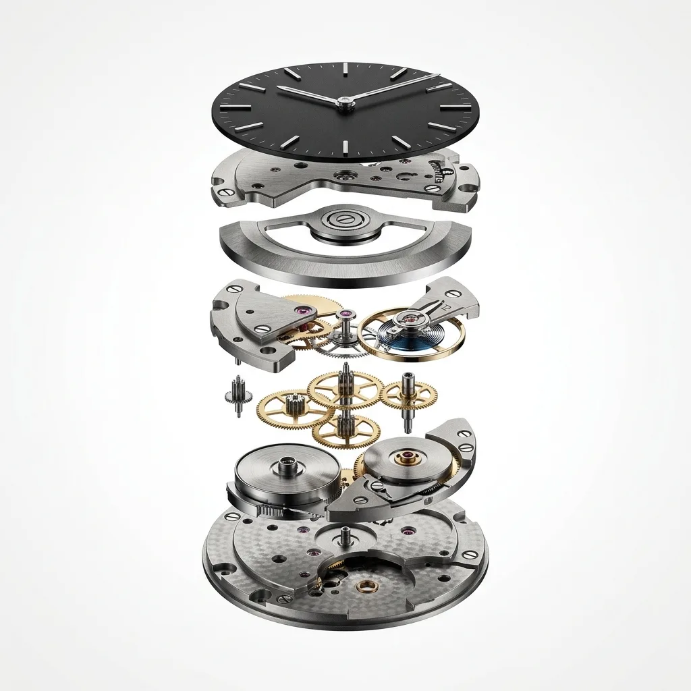

# Refined minimalist Luxury Product Design 2 in Pristine product

[← Back to the collection](../../README.md) · Category: [Illustration & 3D](../../gallery/illustration-3d.md) · Model: `Vinano Image v2` · ID: `vn-00342`

<a href="https://vinano.ai?utm_source=github&utm_medium=readme&utm_campaign=awesome-image-video-prompts-updating&utm_content=prompt-page-image"></a>

<sub>Preview generated with <a href="https://vinano.ai?utm_source=github&utm_medium=readme&utm_campaign=awesome-image-video-prompts-updating&utm_content=prompt-page-caption">vinano.ai</a></sub>

## Prompt

```text
Prompt Studio: refined minimalist Luxury Product Design 2 in

Pristine product visualization, [object] in [material], deconstructed floating parts suspended in a precision-aligned engineering sequence, pure white gradient void subtle depth falloff, sculptural studio lighting sharp rim highlights, mirror-polished and matte surface contrast, ultra-macro lens revealing microscopic [surface detail] and internal [component detail], shallow depth of field isolating the core components, refined minimalist Braun meets Leica aesthetic, heroic product scale presence, product photography.

Check ALTs for ideas 👇

Render with rich micro-detail while keeping the layout uncluttered and intentional.
```

## Try it on vinano.ai

1. Copy the prompt above.
2. Open **[vinano.ai](https://vinano.ai?utm_source=github&utm_medium=readme&utm_campaign=awesome-image-video-prompts-updating&utm_content=prompt-page-try)**, paste it into the image generator and pick a model.
3. Swap any placeholders (brand, product, city, person…) for your own details, then generate.

More prompts like this: [Illustration & 3D gallery](../../gallery/illustration-3d.md) · [all categories](../../README.md#contents)
