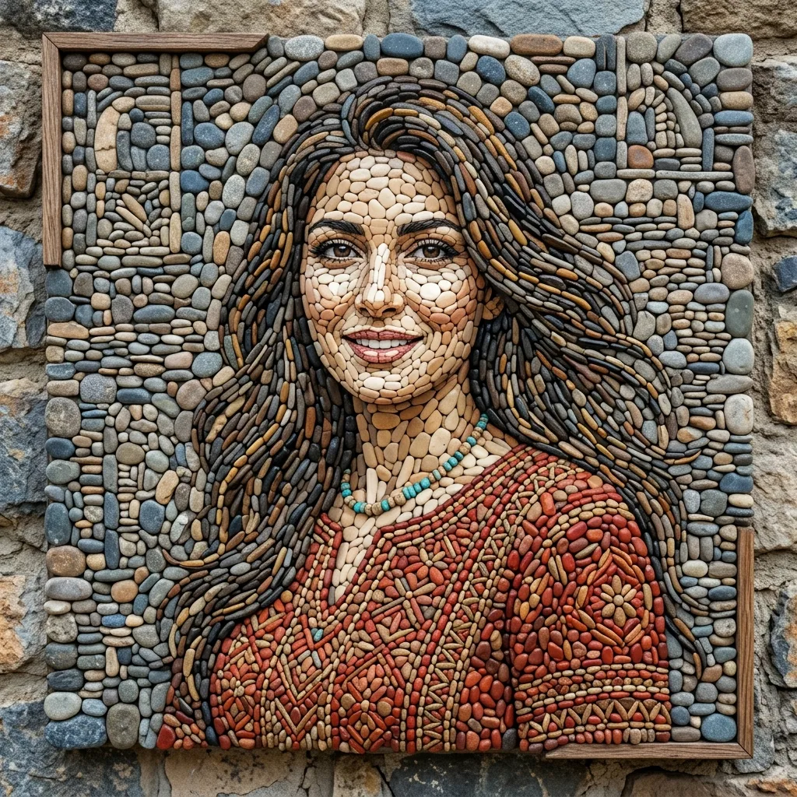

# Highly detailed pebble mosaic portrait of a beautiful woman

[← Back to the collection](../../README.md) · Category: [Illustration & 3D](../../gallery/illustration-3d.md) · Model: `Vinano Image v2` · ID: `vn-00345`

<a href="https://vinano.ai?utm_source=github&utm_medium=readme&utm_campaign=awesome-image-video-prompts-updating&utm_content=prompt-page-image"></a>

<sub>Preview generated with <a href="https://vinano.ai?utm_source=github&utm_medium=readme&utm_campaign=awesome-image-video-prompts-updating&utm_content=prompt-page-caption">vinano.ai</a></sub>

## Prompt

```text
A highly detailed pebble mosaic portrait of a beautiful woman, where the entire image is constructed from thousands of smooth natural stones and pebbles. The pebbles vary in size and color to form realistic facial features, hair, skin tones, and clothing patterns. The woman has long flowing hair and is wearing a richly patterned red traditional dress. The background is also composed of carefully arranged river stones creating a textured mosaic wall. Ultra-detailed stone texture, gemini natural earthy colors, soft, diffused lighting, artistic stone mosaic craftsmanship, gemini true-to-life photorealistic composition, 8k resolution, intricate pebble placement, handcrafted mosaic art style. Aim for an editorial, design-driven look with deliberate negative space.
```

## Try it on vinano.ai

1. Copy the prompt above.
2. Open **[vinano.ai](https://vinano.ai?utm_source=github&utm_medium=readme&utm_campaign=awesome-image-video-prompts-updating&utm_content=prompt-page-try)**, paste it into the image generator and pick a model.
3. Swap any placeholders (brand, product, city, person…) for your own details, then generate.

More prompts like this: [Illustration & 3D gallery](../../gallery/illustration-3d.md) · [all categories](../../README.md#contents)
