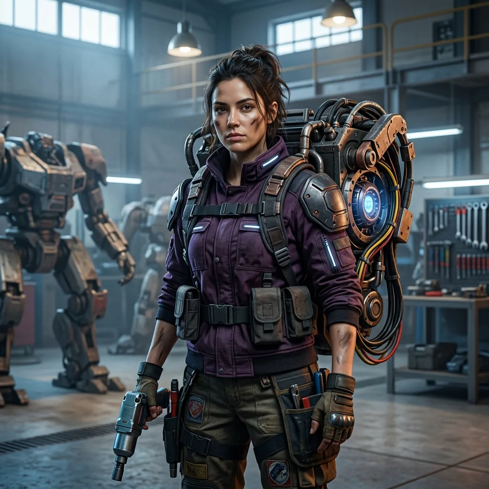

# Exact facial structure, skin texture, and expression retained

[← Back to the collection](../../README.md) · Category: [Illustration & 3D](../../gallery/illustration-3d.md) · Model: `Vinano Image Pro` · ID: `vn-00357`

<a href="https://vinano.ai?utm_source=github&utm_medium=readme&utm_campaign=awesome-image-video-prompts-updating&utm_content=prompt-page-image"></a>

<sub>Preview generated with <a href="https://vinano.ai?utm_source=github&utm_medium=readme&utm_campaign=awesome-image-video-prompts-updating&utm_content=prompt-page-caption">vinano.ai</a></sub>

## Prompt

```text
{
 "type": "image_generation_prompt",
 "style": "ultra-realistic, cinematic, sci-fi mech aesthetic, cyberpunk",
 "resolution": "8K",
 "aspect_ratio": "2:3",
 "scene": {
 "location": "industrial workshop",
 "background": "clean minimal workshop environment subtle machinery elements and soft atmospheric haze"
 },
 "subject": {
 "gender": "female",
 "role": "cyberpunk mechanic",
 "identity": {
 "same_face": true,
 "same_character": true,
 "preserve_facial_features": true,
 "realism": "exact facial structure, skin texture, and expression retained"
 },
 "pose": {
 "stance": "standing strong and confident",
 "body_language": "powerful, grounded posture"
 },
 "appearance": {
 "outfit": {
 "jacket": "purple futuristic techwear jacket",
 "details": ["tactical straps",
 "utility pouches",
 "reinforced armored panels",
 "futuristic cyberpunk textures"]
 }
 },
 "equipment": {
 "exosuit_backpack": {
 "type": "massive mechanical industrial exosuit",
 "components": ["large industrial engine core",
 "exposed wires and cables",
 "metal pipes and hydraulic tubes",
 "heavy mechanical armor plates",
 "mechanical joints and connectors"],
 "style": "futuristic sci-fi mech design, functional and industrial"
 }
 }
 },
 "lighting": {
 "type": "cinematic industrial lighting",
 "details": ["soft dramatic shadows",
 "cool and warm mixed highlights",
 "subtle volumetric light",
 "metal reflections and glow accents"]
 },
 "camera": {
 "focus": "sharp focus on subject and exosuit",
 "depth_of_field": "shallow soft background separation",
 "composition": "centered, full-body or mid-body portrait"
 },
 "quality": {
 "detail_level": "hyper detailed",
 "textures": "ultra realistic skin, fabric, and metal textures",
 "sharpness": "extremely sharp",
 "noise": "clean high-resolution render"
 },
 "mood": "powerful, futuristic, cinematic, sci-fi industrial",
 "constraints": ["no cartoon style",
 "no low detail",
 "no distortion",
 "no watermark",
 "no text overlay",
 "no unrealistic anatomy"],
 "output_goal": "Create a hyper-realistic cinematic portrait of a cyberpunk mechanic girl wearing a massive mechanical exosuit backpack industrial engine components, wires, pipes, and metal armor, standing strong in a minimal workshop environment dramatic lighting and ultra-detailed sci-fi mech aesthetics."
}

Render with rich micro-detail while keeping the layout uncluttered and intentional.
```

## Try it on vinano.ai

1. Copy the prompt above.
2. Open **[vinano.ai](https://vinano.ai?utm_source=github&utm_medium=readme&utm_campaign=awesome-image-video-prompts-updating&utm_content=prompt-page-try)**, paste it into the image generator and pick a model.
3. Swap any placeholders (brand, product, city, person…) for your own details, then generate.

More prompts like this: [Illustration & 3D gallery](../../gallery/illustration-3d.md) · [all categories](../../README.md#contents)
