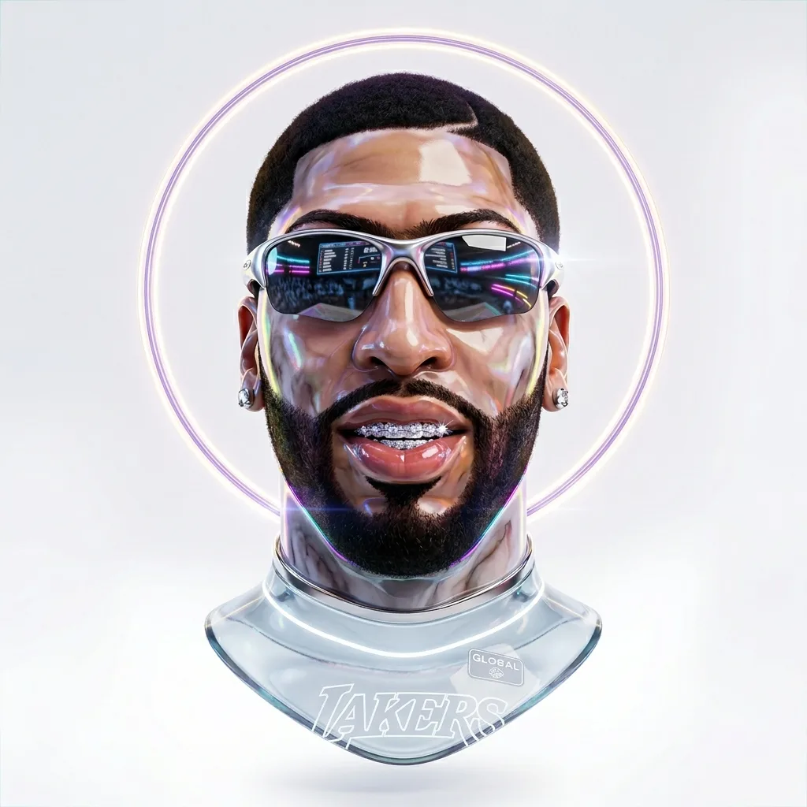

# Hyper-stylized dynamic 3D floating head portrait of the attached

[← Back to the collection](../../README.md) · Category: [Illustration & 3D](../../gallery/illustration-3d.md) · Model: `Vinano Image Pro` · ID: `vn-00359`

<a href="https://vinano.ai?utm_source=github&utm_medium=readme&utm_campaign=awesome-image-video-prompts-updating&utm_content=prompt-page-image"></a>

<sub>Preview generated with <a href="https://vinano.ai?utm_source=github&utm_medium=readme&utm_campaign=awesome-image-video-prompts-updating&utm_content=prompt-page-caption">vinano.ai</a></sub>

## Prompt

```text
Hyper-stylized dynamic 3D floating head portrait of the attached reference image, perfectly centered, upright, symmetrical, filling 80% of the 4:5 frame. No neck. No shoulder edges. Clean cut-out. Subject floating in white space.Predominantly white background enhanced subtle tonal gradients and soft volumetric glow. A thin luminous neon halo ring glows behind the head, slightly diffused but clean and circular.

Facial features match reference photo precisely. Expression: confident, dominant smirk focused eye contact. Diamond-studded braces sparkle under sharp lighting.

Sleek silver sports sunglasses reflect digital stadium lights and neon streaks. Chrome stud earrings and polished silver chain subtly visible.

Official lakers shirt strictly front view chest logo and sponsor visible only.

Lighting combines bright frontal fill strong rim lights. Subtle neon reflections trace along jawline edges. Micro lens flares appear at high-intensity highlights.

White-on-white energy controlled neon accents. Futuristic champion aura. Glossy skin, exaggerated reflections, cinematic intensity.

Aspect ratio 4:5.

Aim for an editorial, design-driven look with deliberate negative space.
```

## Try it on vinano.ai

1. Copy the prompt above.
2. Open **[vinano.ai](https://vinano.ai?utm_source=github&utm_medium=readme&utm_campaign=awesome-image-video-prompts-updating&utm_content=prompt-page-try)**, paste it into the image generator and pick a model.
3. Swap any placeholders (brand, product, city, person…) for your own details, then generate.

More prompts like this: [Illustration & 3D gallery](../../gallery/illustration-3d.md) · [all categories](../../README.md#contents)
