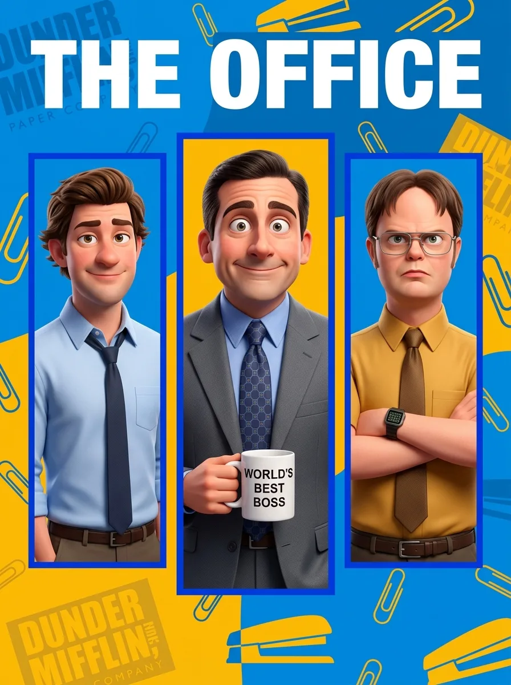

# Pixar/Disney 3D CGI animated movie poster

[← Back to the collection](../../README.md) · Category: [Illustration & 3D](../../gallery/illustration-3d.md) · Model: `Vinano Image Pro` · ID: `vn-00360`

<a href="https://vinano.ai?utm_source=github&utm_medium=readme&utm_campaign=awesome-image-video-prompts-updating&utm_content=prompt-page-image"></a>

<sub>Preview generated with <a href="https://vinano.ai?utm_source=github&utm_medium=readme&utm_campaign=awesome-image-video-prompts-updating&utm_content=prompt-page-caption">vinano.ai</a></sub>

## Prompt

```text
Pixar/Disney 3D CGI animated movie poster. Soft volumetric lighting, smooth subsurface skin shading, expressive Pixar-style faces, polished studio render quality. Vertical poster, 3:4 ratio.
Show/Movie: [SHOW/MOVIE]
Automatically select the 3 most iconic characters from [SHOW/MOVIE]. Render each as a Pixar 3D CGI character recognizable likeness, wearing their single most iconic outfit.
TITLE — LOCKED:
Show title at the very top. ALL CAPS. Pure white. Extra bold sans-serif block font. No outlines, no graphic boxes, no mixed case. Large, centered, one line if possible.
PANELS — LOCKED:
Three vertical panels below the title. Each panel shows ONE character, UPPER BODY from waist up, filling the panel face large and centered. Panel outline is a bold thick stroke in the most iconic accent color of [SHOW/MOVIE] — vivid and saturated, not dark or muted.
∙Left panel: perfectly straight
∙Center panel: perfectly straight, slightly larger than the side panels
∙Right panel: perfectly straight
BACKGROUND — LOCKED FORMAT, VARIABLE PATTERN:
Background uses the 2 most iconic colors of [SHOW/MOVIE] — fully saturated, vivid and punchy, NOT darkened or desaturated. High contrast and visually striking. Behind the panels, fill the background a large abstract graphic pattern directly inspired by the most iconic visual symbol of [SHOW/MOVIE] — blown up, repeating, semi-transparent. Examples: Breaking Bad = oversized molecular/chemical structures in bright yellow-green. Stranger Things = tangled vine tendrils in vivid red. Peaky Blinders = repeating razor blade motif in sharp silver-burgundy. The Sopranos = bold pinstripe pattern in navy and gold. No scenes, no characters, no locations in the background. Pattern only. Overall image must feel bold, vibrant, energetic and eye-catching — like a premium comic poster, not a muted cinematic still.
RULES:
∙Upper body only — waist to top of head, face prominent and large inside panel
∙Pure white ALL CAPS bold title only — no other text
∙No character names, no watermarks, no logos, no extra graphic elements
∙Colors must be vivid, saturated and high contrast throughout — no muted, faded or desaturated tones anywhere
∙8K, professional Pixar studio render quality

Render with rich micro-detail while keeping the layout uncluttered and intentional.
```

## Try it on vinano.ai

1. Copy the prompt above.
2. Open **[vinano.ai](https://vinano.ai?utm_source=github&utm_medium=readme&utm_campaign=awesome-image-video-prompts-updating&utm_content=prompt-page-try)**, paste it into the image generator and pick a model.
3. Swap any placeholders (brand, product, city, person…) for your own details, then generate.

More prompts like this: [Illustration & 3D gallery](../../gallery/illustration-3d.md) · [all categories](../../README.md#contents)
