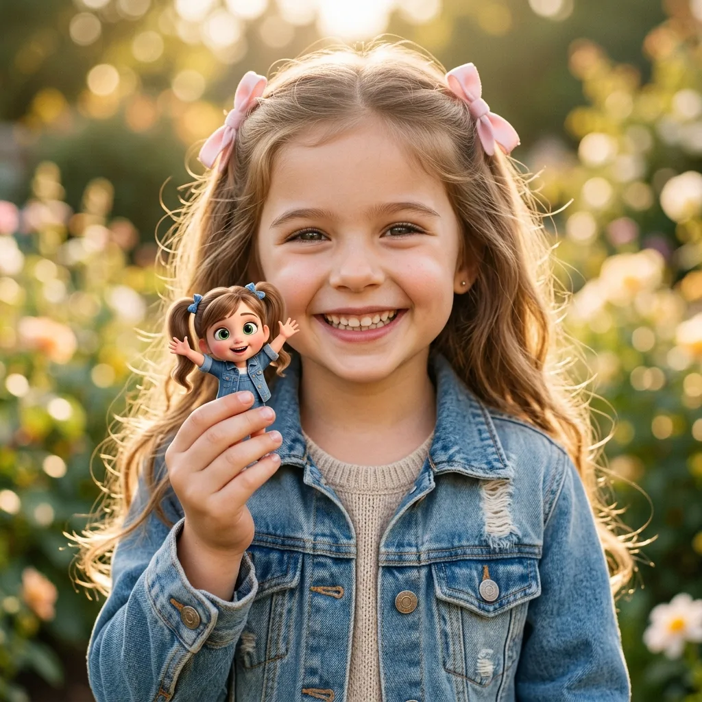

# Close-up to medium portrait

[← Back to the collection](../../README.md) · Category: [Illustration & 3D](../../gallery/illustration-3d.md) · Model: `Vinano Image v2` · ID: `vn-00369`

<a href="https://vinano.ai?utm_source=github&utm_medium=readme&utm_campaign=awesome-image-video-prompts-updating&utm_content=prompt-page-image"></a>

<sub>Preview generated with <a href="https://vinano.ai?utm_source=github&utm_medium=readme&utm_campaign=awesome-image-video-prompts-updating&utm_content=prompt-page-caption">vinano.ai</a></sub>

## Prompt

```text
{
 "Objective": "Create a heartwarming, whimsical portrait blending true-to-life photorealistic realism a tiny Pixar-style animated character",
 "PersonaDetails": {
 "PrimarySubject": {
 "Type": "Young girl",
 "Expression": "Bright, joyful smile",
 "Hair": {
 "Style": "Long light-brown hair",
 "Accessories": "Cute ribbon bows"
 },
 "Wardrobe": {
 "Outerwear": "Casual denim jacket",
 "Top": "Soft neutral-colored shirt"
 }
 },
 "SecondarySubject": {
 "Type": "Tiny 3D cartoon version of the girl",
 "Scale": "Miniature, held delicately between fingers",
 "Style": "Pixar-style 3D character",
 "Proportions": "Oversized expressive eyes, rounded features",
 "Hair": "Pigtails matching the real girl",
 "Wardrobe": "Denim outfit matching the real subject",
 "Pose": "Arms raised joyfully"
 }
 },
 "Composition": {
 "Framing": "Close-up to medium portrait",
 "Interaction": "Clear playful interaction between girl and miniature character",
 "DepthOfField": "Shallow depth of field",
 "Focus": "Ultra-sharp focus on both faces"
 },
 "LightingAndBackground": {
 "Lighting": "Warm natural daylight",
 "Background": {
 "Style": "Soft golden bokeh",
 "Mood": "Dreamy, magical"
 }
 },
 "ArtDirection": {
 "StyleFusion": ["true-to-life photorealistic child portrait photography",
 "Pixar-style 3D animated character"],
 "Aesthetic": "Magical realism playful scale contrast",
 "TextureDetail": "Ultra-detailed skin, fabric, and 3D materials"
 },
 "MoodAndTone": {
 "Mood": "Heartwarming, joyful, whimsical",
 "EmotionalFeel": "Wonder, innocence, playful imagination"
 },
 "PhotographyStyle": {
 "Genre": "Cinematic lifestyle portrait photography",
 "LensFeel": "Portrait lens creamy bokeh",
 "ImageQuality": "8K ultra-high realism"
 },
 "NegativePrompt": ["uncanny valley",
 "scary doll",
 "low-quality 3D",
 "harsh lighting",
 "oversaturated colors",
 "blurry focus",
 "flat expression"],
 "ResponseFormat": {
 "Type": "Single image",
 "Orientation": "Portrait",
 "AspectRatio": "2:3"
 }
}

Maintain consistent colour harmony and crisp focus across the whole frame.
```

## Try it on vinano.ai

1. Copy the prompt above.
2. Open **[vinano.ai](https://vinano.ai?utm_source=github&utm_medium=readme&utm_campaign=awesome-image-video-prompts-updating&utm_content=prompt-page-try)**, paste it into the image generator and pick a model.
3. Swap any placeholders (brand, product, city, person…) for your own details, then generate.

More prompts like this: [Illustration & 3D gallery](../../gallery/illustration-3d.md) · [all categories](../../README.md#contents)
