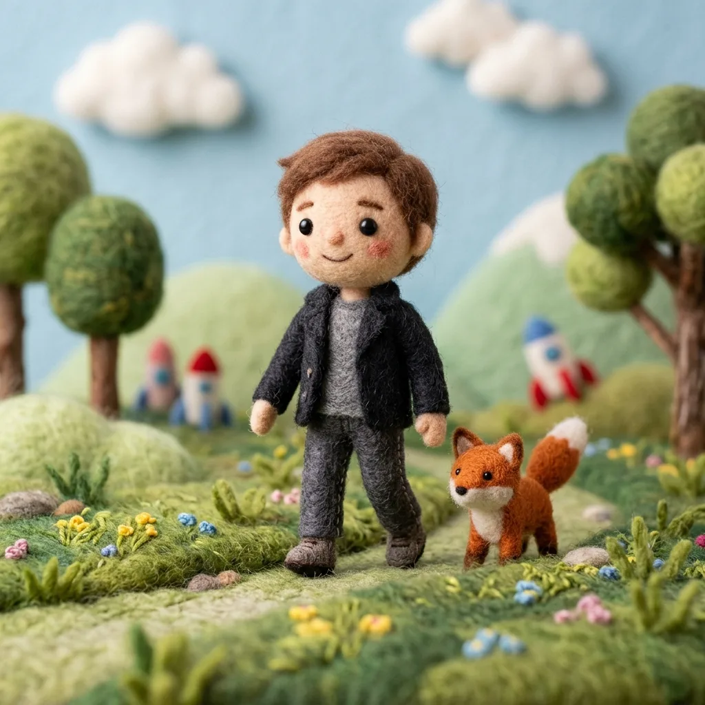

# Handcrafted felt miniature scene featuring a soft wool doll

[← Back to the collection](../../README.md) · Category: [Illustration & 3D](../../gallery/illustration-3d.md) · Model: `Vinano Image v2` · ID: `vn-00373`

<a href="https://vinano.ai?utm_source=github&utm_medium=readme&utm_campaign=awesome-image-video-prompts-updating&utm_content=prompt-page-image"></a>

<sub>Preview generated with <a href="https://vinano.ai?utm_source=github&utm_medium=readme&utm_campaign=awesome-image-video-prompts-updating&utm_content=prompt-page-caption">vinano.ai</a></sub>

## Prompt

```text
A handcrafted felt miniature scene featuring a soft wool doll character simplified facial features, round button eyes, rosy cheeks, and a gentle smile. The character wears a dark felt jacket, gray wool t-shirt, and matching trousers, styled in a minimal casual tech look. He is walking on grassy felt terrain alongside a small felt fox companion. Whimsical storybook environment pastel greenery, soft clouds, and a bright blue sky, subtle miniature rockets blurred in the background. Macro photography style, shallow depth of field, soft natural daylight, stop-motion animation aesthetic, ultra-detailed felt fibers and fabric textures, cozy cinematic mood, premium quality. Render with rich micro-detail while keeping the layout uncluttered and intentional.
```

## Try it on vinano.ai

1. Copy the prompt above.
2. Open **[vinano.ai](https://vinano.ai?utm_source=github&utm_medium=readme&utm_campaign=awesome-image-video-prompts-updating&utm_content=prompt-page-try)**, paste it into the image generator and pick a model.
3. Swap any placeholders (brand, product, city, person…) for your own details, then generate.

More prompts like this: [Illustration & 3D gallery](../../gallery/illustration-3d.md) · [all categories](../../README.md#contents)
