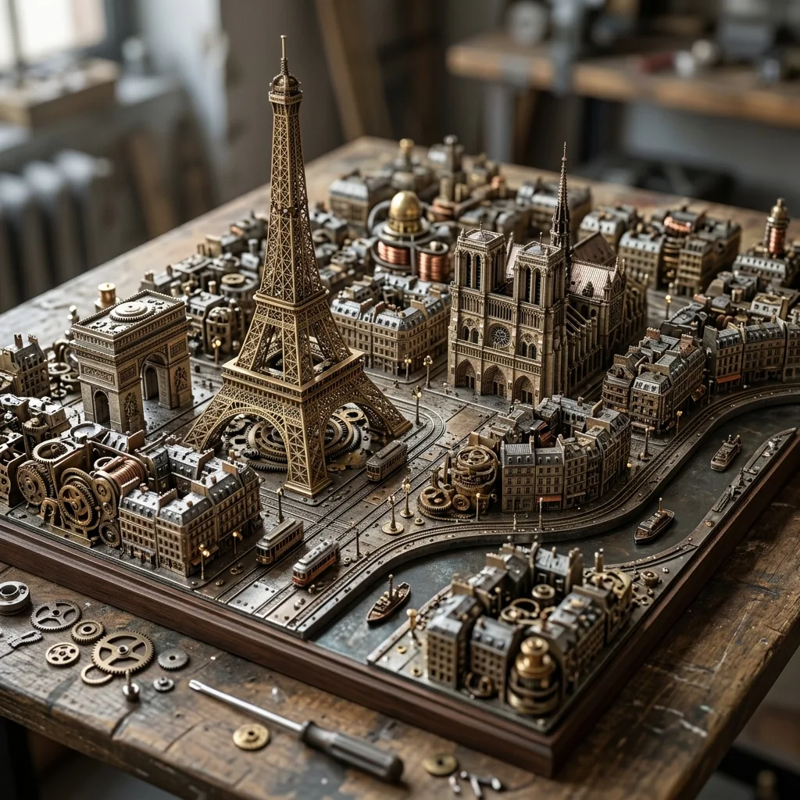

# Illustration & 3D prompt #376

[← Back to the collection](../../README.md) · Category: [Illustration & 3D](../../gallery/illustration-3d.md) · Model: `Vinano Image Pro` · ID: `vn-00376`

<a href="https://vinano.ai?utm_source=github&utm_medium=readme&utm_campaign=awesome-image-video-prompts-updating&utm_content=prompt-page-image"></a>

<sub>Preview generated with <a href="https://vinano.ai?utm_source=github&utm_medium=readme&utm_campaign=awesome-image-video-prompts-updating&utm_content=prompt-page-caption">vinano.ai</a></sub>

## Prompt

```text
(Paris, PC) Anchor: [Location]:: [Material Concept]::4
Morphology: Miniature architectural cityscape of [Location], entire skyline constructed the assemblage of [Material Concept] components, skyscrapers and structures formed from the constituent parts of [Material Concept], thematic structural engineering, hyper-detailed diorama::3
Material Physics: Physical properties of [Material Concept] applied to architecture, [Material Concept] textures replacing concrete and glass, innate material logic of [Material Concept], high-fidelity surface details::3
Illumination: Lighting exhibiting the surface properties of [Material Concept], ambient occlusion, volumetric atmosphere matching the material theme::2
Render Stack: Tilt-shift photography, macro lens, f/2.8, 8k, scale model aesthetic, detailed texture mapping, Unreal Engine 5 render::1
Negative: [Human presence, massive scale, blurry, low resolution, bad geometry, distortions, flat 2D, text, watermark]:: -1

Render with rich micro-detail while keeping the layout uncluttered and intentional.
```

## Try it on vinano.ai

1. Copy the prompt above.
2. Open **[vinano.ai](https://vinano.ai?utm_source=github&utm_medium=readme&utm_campaign=awesome-image-video-prompts-updating&utm_content=prompt-page-try)**, paste it into the image generator and pick a model.
3. Swap any placeholders (brand, product, city, person…) for your own details, then generate.

More prompts like this: [Illustration & 3D gallery](../../gallery/illustration-3d.md) · [all categories](../../README.md#contents)
