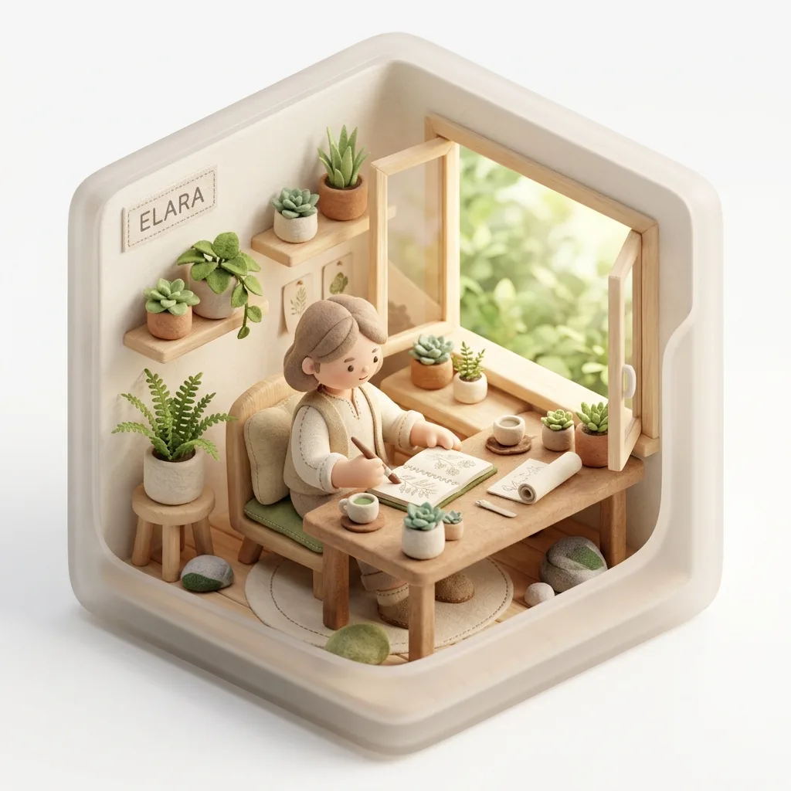

# 3D isometric diorama illustration of an original character named

[← Back to the collection](../../README.md) · Category: [Illustration & 3D](../../gallery/illustration-3d.md) · Model: `Vinano Image Pro` · ID: `vn-00377`

<a href="https://vinano.ai?utm_source=github&utm_medium=readme&utm_campaign=awesome-image-video-prompts-updating&utm_content=prompt-page-image"></a>

<sub>Preview generated with <a href="https://vinano.ai?utm_source=github&utm_medium=readme&utm_campaign=awesome-image-video-prompts-updating&utm_content=prompt-page-caption">vinano.ai</a></sub>

## Prompt

```text
Create a 3D isometric diorama illustration of an original character named [CHARACTER NAME], peacefully working or practicing a creative activity in a nature-inspired environment, sitting at a wooden desk near a large open window sunlight flowing in and soft greenery visible outside.

The character should be inspired by [ARCHETYPE / PROFESSION – e.g. writer, painter, meditator, calligraphy artist, tea master] and have a unique visual identity, including soft, natural clothing, organic textures, and a calm, introspective personality.

The entire scene must have a handcrafted felt aesthetic, soft rounded shapes, visible stitching details, and clean, polished textures.

The diorama is enclosed inside a rounded cube structure subtle hexagonal proportions, made of [MATERIAL STYLE – e.g. soft matte ceramic, light frosted resin, natural wood finish].

The environment must strongly reflect a peaceful, nature-connected lifestyle, including plants, natural wood furniture, soft textiles, and minimalistic decor.

On the desk, include small detailed objects such as [OBJECT 1 – e.g. tea cup], [OBJECT 2 – e.g. brush or pen], [OBJECT 3 – e.g. notebook or scroll].

Lighting should be bright, soft, and natural, warm sunlight beams entering through the window, creating a serene and airy atmosphere, a clean white background outside the diorama.

Render in 1080x1080, ultra-detailed, true-to-life photorealistic style.

Include a small stitched fabric name tag sewn onto the INNER wall of the diorama (top-left corner inside the cube), clearly integrated into the scene, not floating and not outside the structure, displaying the name: [CHARACTER NAME].

Maintain consistent colour harmony and crisp focus across the whole frame.
```

## Try it on vinano.ai

1. Copy the prompt above.
2. Open **[vinano.ai](https://vinano.ai?utm_source=github&utm_medium=readme&utm_campaign=awesome-image-video-prompts-updating&utm_content=prompt-page-try)**, paste it into the image generator and pick a model.
3. Swap any placeholders (brand, product, city, person…) for your own details, then generate.

More prompts like this: [Illustration & 3D gallery](../../gallery/illustration-3d.md) · [all categories](../../README.md#contents)
