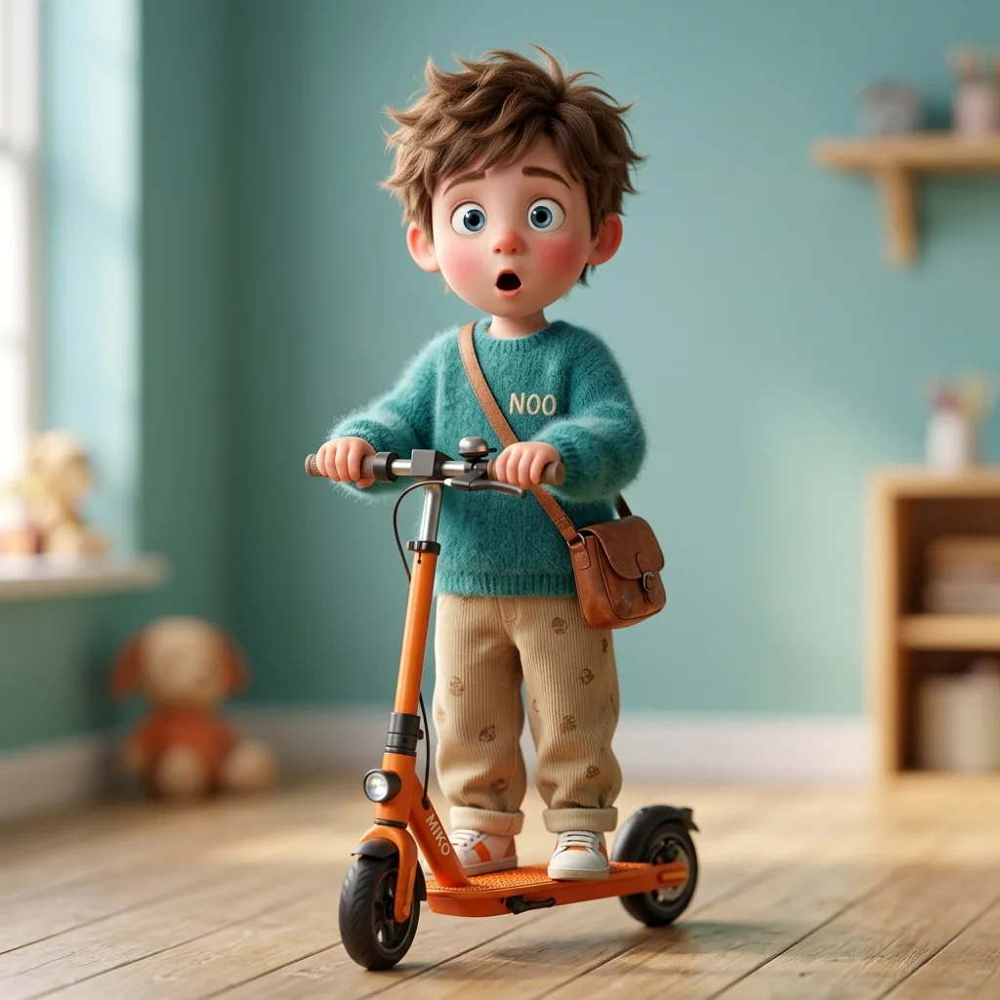

# 3D Pixar-style animated child character, cute young boy messy

[← Back to the collection](../../README.md) · Category: [Illustration & 3D](../../gallery/illustration-3d.md) · Model: `Vinano Image v2` · ID: `vn-00379`

<a href="https://vinano.ai?utm_source=github&utm_medium=readme&utm_campaign=awesome-image-video-prompts-updating&utm_content=prompt-page-image"></a>

<sub>Preview generated with <a href="https://vinano.ai?utm_source=github&utm_medium=readme&utm_campaign=awesome-image-video-prompts-updating&utm_content=prompt-page-caption">vinano.ai</a></sub>

## Prompt

```text
3D Pixar-style animated child character, cute young boy messy brown hair and big expressive blue eyes, surprised open-mouth expression, soft round face, wearing a fuzzy teal sweater small “noo” text on chest, loose beige patterned pants, white sneakers, small brown crossbody bag, standing on an orange electric scooter, minimal teal studio background, soft, diffused lighting, ultra-detailed textures (fabric fuzz, skin, hair), cinematic depth of field, vibrant colors, highly polished render, octane render, 4k Emphasise material texture and natural light so the final frame feels tactile and premium.
```

## Try it on vinano.ai

1. Copy the prompt above.
2. Open **[vinano.ai](https://vinano.ai?utm_source=github&utm_medium=readme&utm_campaign=awesome-image-video-prompts-updating&utm_content=prompt-page-try)**, paste it into the image generator and pick a model.
3. Swap any placeholders (brand, product, city, person…) for your own details, then generate.

More prompts like this: [Illustration & 3D gallery](../../gallery/illustration-3d.md) · [all categories](../../README.md#contents)
