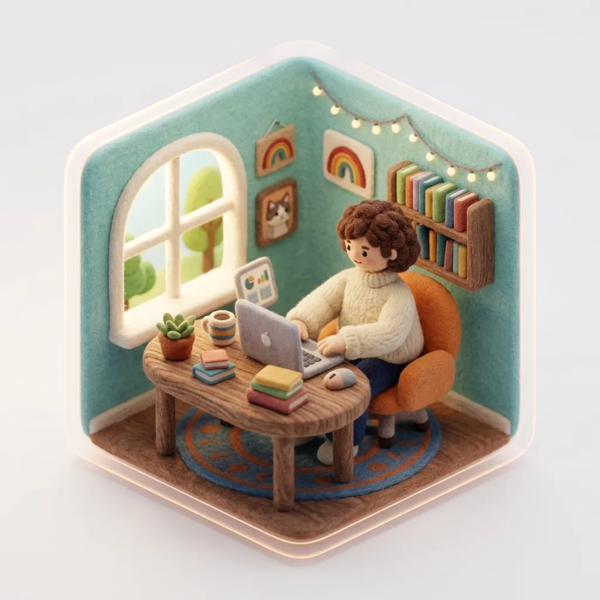

# 3D isometric diorama illustration of CHARACTER working from home

[← Back to the collection](../../README.md) · Category: [Illustration & 3D](../../gallery/illustration-3d.md) · Model: `Vinano Image Pro` · ID: `vn-00384`

<a href="https://vinano.ai?utm_source=github&utm_medium=readme&utm_campaign=awesome-image-video-prompts-updating&utm_content=prompt-page-image"></a>

<sub>Preview generated with <a href="https://vinano.ai?utm_source=github&utm_medium=readme&utm_campaign=awesome-image-video-prompts-updating&utm_content=prompt-page-caption">vinano.ai</a></sub>

## Prompt

```text
Generate a 3D isometric diorama illustration of [CHARACTER] working from home at a desk a laptop and a window. Handmade felt appearance rounded polished shapes, enclosed in a hexagonal rounded cube frame. The room decor, colours, furniture, wall art, and accessories are all instantly recognisable to [CHARACTER] — reflecting their signature style, iconic items, outfit, and personality. Warm soft, diffused lighting, clean white background, 1080x1080, true-to-life photorealistic quality. No text labels or signs on the base. Emphasise material texture and natural light so the final frame feels tactile and premium.
```

## Try it on vinano.ai

1. Copy the prompt above.
2. Open **[vinano.ai](https://vinano.ai?utm_source=github&utm_medium=readme&utm_campaign=awesome-image-video-prompts-updating&utm_content=prompt-page-try)**, paste it into the image generator and pick a model.
3. Swap any placeholders (brand, product, city, person…) for your own details, then generate.

More prompts like this: [Illustration & 3D gallery](../../gallery/illustration-3d.md) · [all categories](../../README.md#contents)
