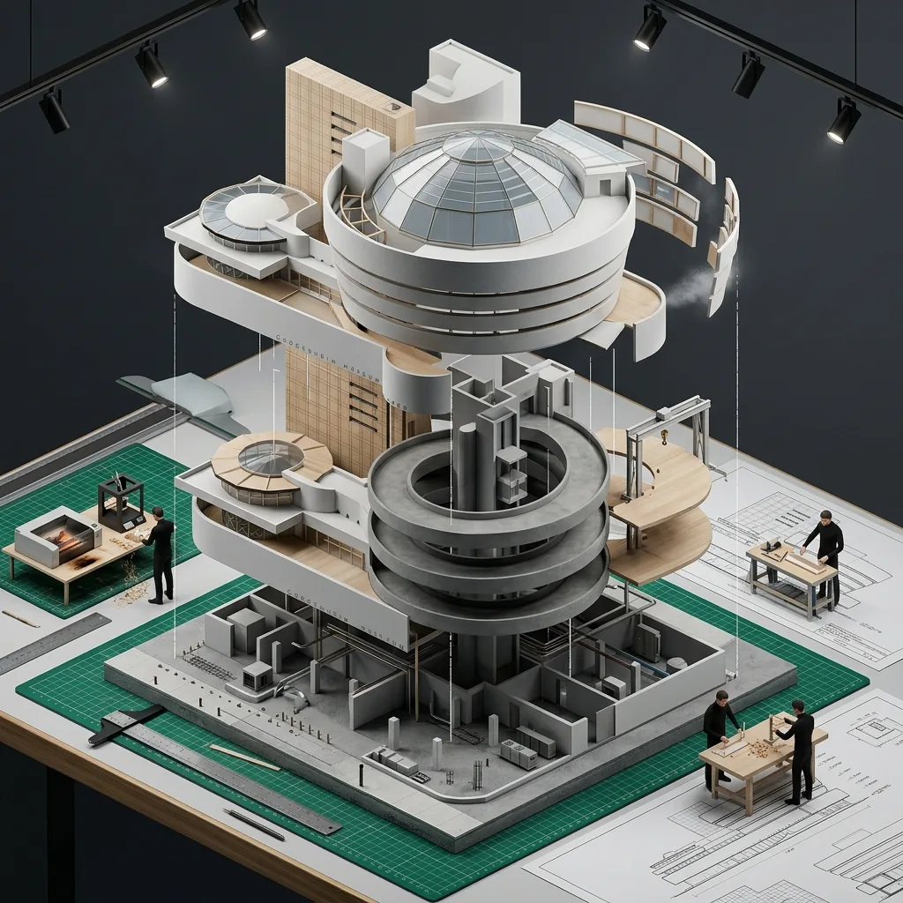

# Any Famous Building

[← Back to the collection](../../README.md) · Category: [Illustration & 3D](../../gallery/illustration-3d.md) · Model: `Vinano Image Pro` · ID: `vn-00386`

<a href="https://vinano.ai?utm_source=github&utm_medium=readme&utm_campaign=awesome-image-video-prompts-updating&utm_content=prompt-page-image"></a>

<sub>Preview generated with <a href="https://vinano.ai?utm_source=github&utm_medium=readme&utm_campaign=awesome-image-video-prompts-updating&utm_content=prompt-page-caption">vinano.ai</a></sub>

## Prompt

```text
Input Variable: [Any Famous Building - Guggenheim, Burj Khalifa, Sydney Opera House, etc.]
System Instruction:
Generate a hyper-realistic, isometric 3D "Exploded View" diorama showing the Input Building deconstructed into its structural systems an architectural model-making crew assembling a scale version.
1. Semantic Engineering Analysis:

Layer 1 (The Skin): Exterior facade panels, windows, cladding, roofing, entrance canopy
Layer 2 (The Structure): Steel framework, floor plates, columns, beams, elevator shafts, stairwells, mechanical systems
Layer 3 (The Foundation): Basement levels, support pillars, utility conduits, HVAC units, individual rivets/bolts, rebar cages

2. Container:

Surface: Architect's drafting table cutting mats and T-squares
Layout: Building layers stacked vertically showing ground-up construction sequence
Connections: White architectural section lines showing structural load paths and circulation
Additional Elements: Blueprint sheets, scale rulers, material samples, elevation drawings

3. Micro-Narrative:

CRITICAL: This is meta - tiny workers building a model that's being built by tiny workers. Recursive scale concept.
Workers: 1:87 scale model makers in black turtlenecks (architect stereotype)
Equipment: Laser cutters, 3D printers, basswood cutting stations, acrylic gluing rigs, miniature cranes positioning floor plates
Interaction: Architects cutting foam core, assembling balsa wood frames, installing tiny windows, spray painting facades, arranging scale furniture

4. Visual Syntax & Material Physics:

Materials: Basswood grain, clear acrylic sheets, white foam core, brass rod framework, museum board textures
Lighting: Architecture studio track lighting creating dramatic model shadows
Special Effects: Glue strands, wood shavings, spray paint mist, laser cutter burn marks
Output: Elevated three-quarter view, architectural presentation, 1:1 ratio, 8K, Archdaily model photography aesthetic

Aim for an editorial, design-driven look with deliberate negative space.
```

## Try it on vinano.ai

1. Copy the prompt above.
2. Open **[vinano.ai](https://vinano.ai?utm_source=github&utm_medium=readme&utm_campaign=awesome-image-video-prompts-updating&utm_content=prompt-page-try)**, paste it into the image generator and pick a model.
3. Swap any placeholders (brand, product, city, person…) for your own details, then generate.

More prompts like this: [Illustration & 3D gallery](../../gallery/illustration-3d.md) · [all categories](../../README.md#contents)
