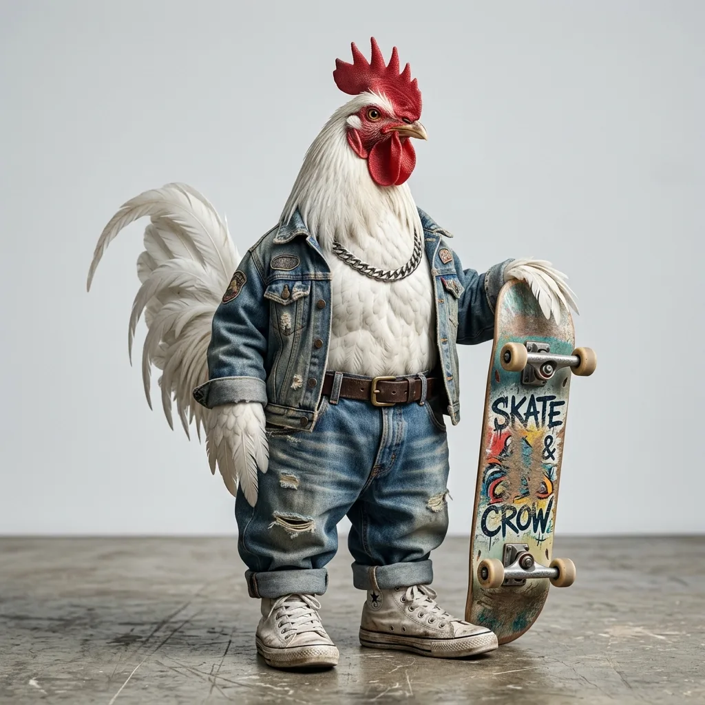

# Studio portrait of an anthropomorphic rooster styled like

[← Back to the collection](../../README.md) · Category: [Illustration & 3D](../../gallery/illustration-3d.md) · Model: `Vinano Image v2` · ID: `vn-00391`

<a href="https://vinano.ai?utm_source=github&utm_medium=readme&utm_campaign=awesome-image-video-prompts-updating&utm_content=prompt-page-image"></a>

<sub>Preview generated with <a href="https://vinano.ai?utm_source=github&utm_medium=readme&utm_campaign=awesome-image-video-prompts-updating&utm_content=prompt-page-caption">vinano.ai</a></sub>

## Prompt

```text
Ultra-realistic studio portrait of an anthropomorphic rooster styled like a street skater. A confident white rooster a red comb and wattles stands upright like a human, full body visible, facing slightly to the side. The rooster is wearing oversized vintage blue denim jeans a loose, baggy fit, a faded denim jacket hanging off the shoulders, and a thick silver chain necklace around its neck. A brown leather belt is fastened tightly around the waist.
The rooster is holding a worn skateboard vertically one wing, resting it on the floor. The skateboard has scratched trucks, beige wheels, and a distressed, colorful deck. On its feet are chunky white high-top sneakers visible wear and realistic fabric texture.
Highly detailed feathers realistic texture and volume, sharp focus on the rooster’s face and clothing. Studio lighting soft shadows, clean white/neutral background, fashion editorial style. Cinematic realism, humorous yet stylish vibe, perfect balance between realism and surreal character design. Ultra-high resolution, hyper-detailed materials (denim fabric, leather belt, metal chain, feathers), shallow depth of field, professional photography look.

Aim for an editorial, design-driven look with deliberate negative space.
```

## Try it on vinano.ai

1. Copy the prompt above.
2. Open **[vinano.ai](https://vinano.ai?utm_source=github&utm_medium=readme&utm_campaign=awesome-image-video-prompts-updating&utm_content=prompt-page-try)**, paste it into the image generator and pick a model.
3. Swap any placeholders (brand, product, city, person…) for your own details, then generate.

More prompts like this: [Illustration & 3D gallery](../../gallery/illustration-3d.md) · [all categories](../../README.md#contents)
