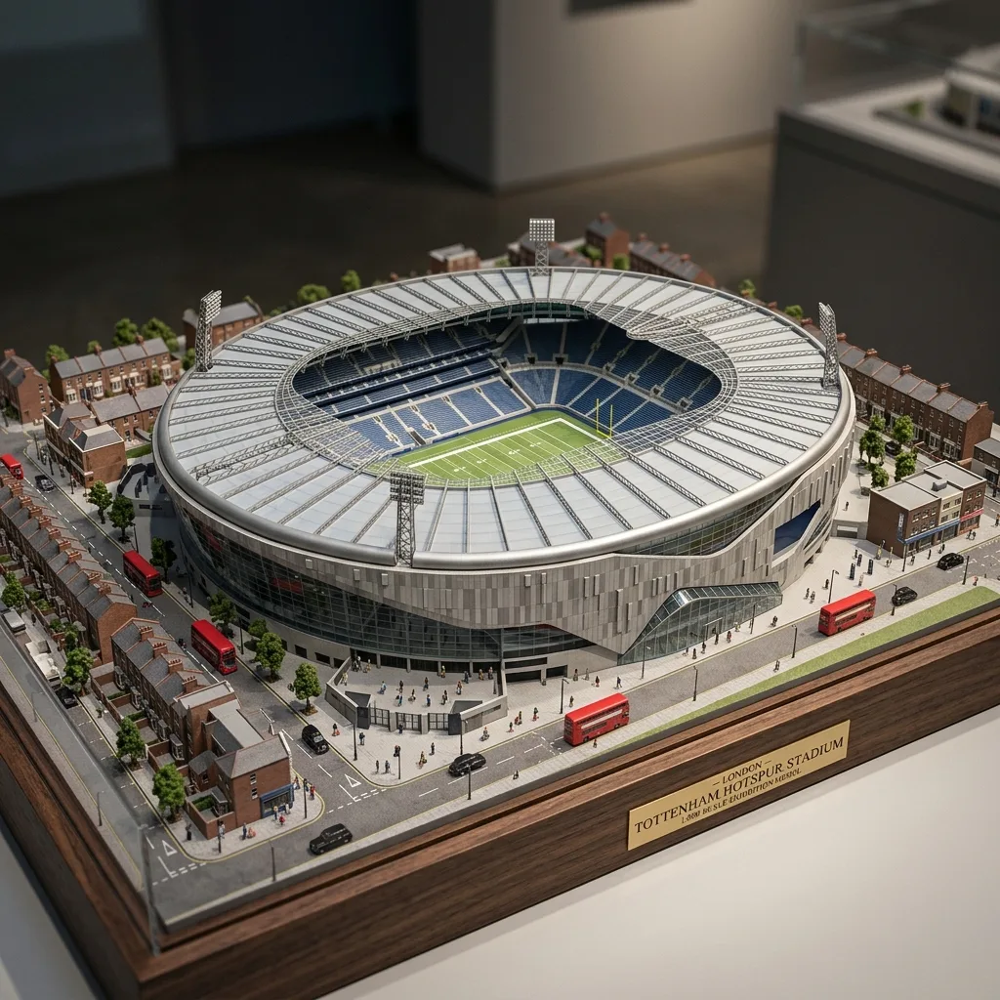

# Ultra-detailed large-scale miniature diorama of STADIUM NAME in CITY

[← Back to the collection](../../README.md) · Category: [Illustration & 3D](../../gallery/illustration-3d.md) · Model: `Vinano Image Pro` · ID: `vn-00392`

<a href="https://vinano.ai?utm_source=github&utm_medium=readme&utm_campaign=awesome-image-video-prompts-updating&utm_content=prompt-page-image"></a>

<sub>Preview generated with <a href="https://vinano.ai?utm_source=github&utm_medium=readme&utm_campaign=awesome-image-video-prompts-updating&utm_content=prompt-page-caption">vinano.ai</a></sub>

## Prompt

```text
Ultra-detailed large-scale miniature diorama of [STADIUM NAME] in [CITY] presented as a premium museum-quality desktop exhibition model.
True architectural scale model craftsmanship extreme fine detail.
[STADIUM NAME] fully visible and centered in the composition: iconic roof structure, exterior facade details, floodlight towers rising dramatically, the entire stadium accurately represented from ground level to roof.
Surrounding miniature [CITY] city blocks: small local-style residential buildings, grid street layout, tiny trees lining the sidewalks, mini cars and pedestrians for scale realism.
Ground textures: stone pavements, micro streetlights, tiny fan plazas and entrance gates surrounding the stadium.
Materials: realistic miniature concrete and steel texture, matte architectural model surfaces, precise structural detailing, museum-grade craftsmanship.
Display base: elegant rectangular exhibition base, subtle engraved metal plate reading “[CITY] – [STADIUM NAME]”.
Lighting: soft museum spotlighting from above, gentle shadows enhancing the structural details, clean studio environment.
Camera: slightly elevated macro architectural photography angle, tilt-shift miniature aesthetic, center extremely sharp slight edge depth falloff.
Ultra realistic collectible stadium model, 8K resolution, luxury museum exhibition presentation.
Aspect ratio 4:5 vertical

Emphasise material texture and natural light so the final frame feels tactile and premium.
```

## Try it on vinano.ai

1. Copy the prompt above.
2. Open **[vinano.ai](https://vinano.ai?utm_source=github&utm_medium=readme&utm_campaign=awesome-image-video-prompts-updating&utm_content=prompt-page-try)**, paste it into the image generator and pick a model.
3. Swap any placeholders (brand, product, city, person…) for your own details, then generate.

More prompts like this: [Illustration & 3D gallery](../../gallery/illustration-3d.md) · [all categories](../../README.md#contents)
