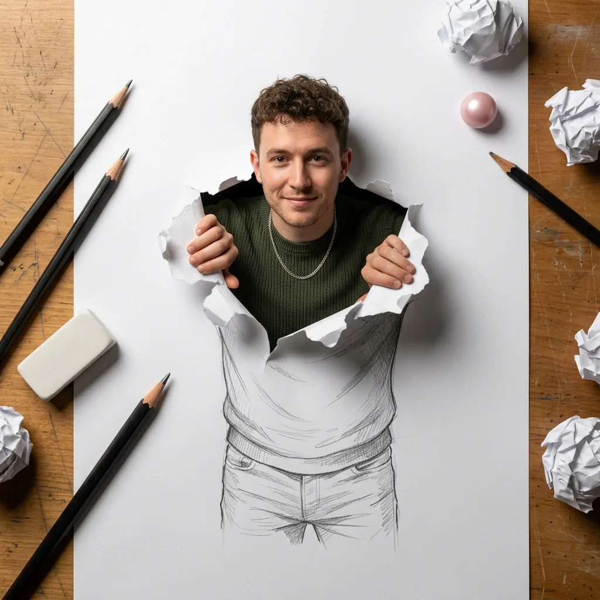

# Trompe L’oeil 3D composition, where the subject— an uploaded

[← Back to the collection](../../README.md) · Category: [Illustration & 3D](../../gallery/illustration-3d.md) · Model: `Vinano Image v2` · ID: `vn-00400`

<a href="https://vinano.ai?utm_source=github&utm_medium=readme&utm_campaign=awesome-image-video-prompts-updating&utm_content=prompt-page-image"></a>

<sub>Preview generated with <a href="https://vinano.ai?utm_source=github&utm_medium=readme&utm_campaign=awesome-image-video-prompts-updating&utm_content=prompt-page-caption">vinano.ai</a></sub>

## Prompt

```text
A stunning Trompe L’oeil 3D composition, where the subject— an uploaded face as reference—appears to physically tear through a clean white drawing paper and emerge from a graphite sketch into the real world. The subject’s upper body is fully rendered in hyper-realistic color and texture, wearing the same clothes from the uploaded image, while the lower body remains a 2D pencil sketch on paper. Shot from an aerial (top-down) perspective a 24mm lens to capture the entire drawing desk environment, including oversized pencils and erasers scattered around. The lighting is a blend of flat studio light for the paper area and dramatic side lighting volumetric effects for the emerging 3D figure, casting realistic shadows that fall back onto the sketch area. 8K resolution, ray tracing, and advanced shading techniques are used to blur the boundary between illustration and reality in this extraordinary surrealist piece. Maintain consistent colour harmony and crisp focus across the whole frame.
```

## Try it on vinano.ai

1. Copy the prompt above.
2. Open **[vinano.ai](https://vinano.ai?utm_source=github&utm_medium=readme&utm_campaign=awesome-image-video-prompts-updating&utm_content=prompt-page-try)**, paste it into the image generator and pick a model.
3. Swap any placeholders (brand, product, city, person…) for your own details, then generate.

More prompts like this: [Illustration & 3D gallery](../../gallery/illustration-3d.md) · [all categories](../../README.md#contents)
