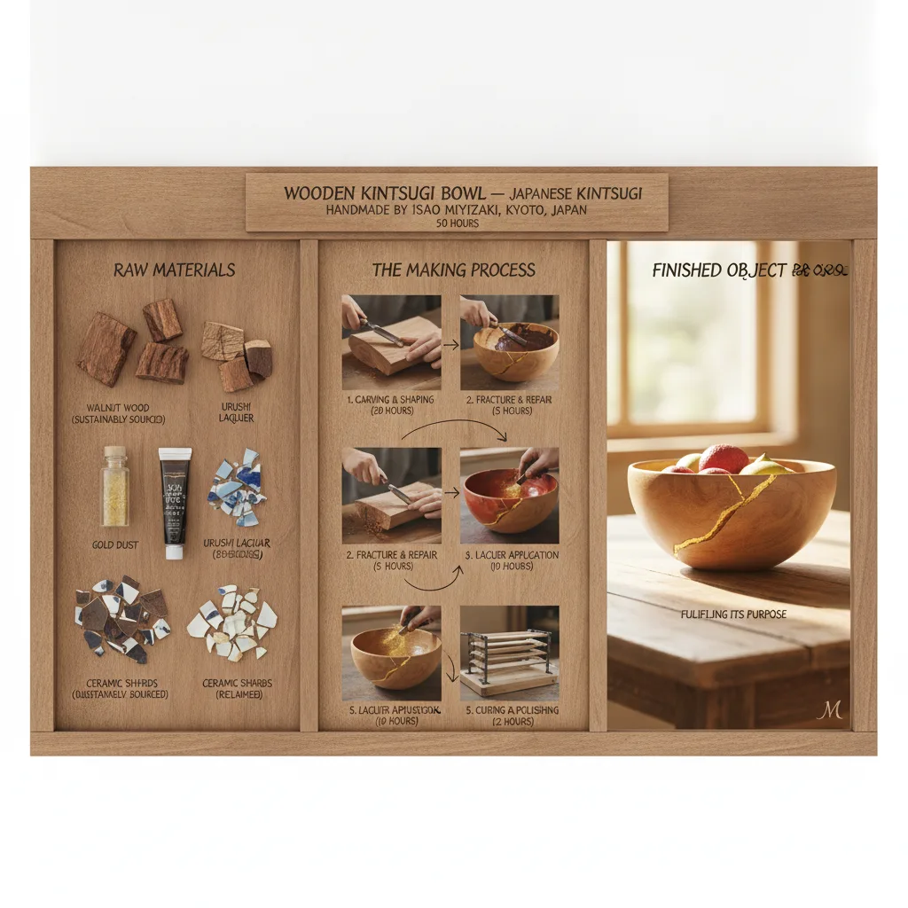

# Artisan's method board for HANDMADE OBJECT

[← Back to the collection](../../README.md) · Category: [Illustration & 3D](../../gallery/illustration-3d.md) · Model: `Vinano Image` · ID: `vn-00407`

<a href="https://vinano.ai?utm_source=github&utm_medium=readme&utm_campaign=awesome-image-video-prompts-updating&utm_content=prompt-page-image"></a>

<sub>Preview generated with <a href="https://vinano.ai?utm_source=github&utm_medium=readme&utm_campaign=awesome-image-video-prompts-updating&utm_content=prompt-page-caption">vinano.ai</a></sub>

## Prompt

```text
An artisan's method board for [HANDMADE OBJECT] — [TECHNIQUE / TRADITION / ORIGIN]. Left section: raw materials in unprocessed state, sourced and labeled, the transformation yet to begin. Center section: the making documented in sequential stages, hands visible throughout, tools identified, key decision points annotated, time invested at each phase noted. Right section: the finished object in use context, bearing the maker's mark, fulfilling its purpose, the hours invisible but embedded. Visual style transitions from raw material earth tones through workshop warmth to lifestyle context natural light. Title block reading "[OBJECT NAME] — HANDMADE BY [MAKER], [LOCATION], [HOURS] HOURS". Maintain consistent colour harmony and crisp focus across the whole frame.
```

## Try it on vinano.ai

1. Copy the prompt above.
2. Open **[vinano.ai](https://vinano.ai?utm_source=github&utm_medium=readme&utm_campaign=awesome-image-video-prompts-updating&utm_content=prompt-page-try)**, paste it into the image generator and pick a model.
3. Swap any placeholders (brand, product, city, person…) for your own details, then generate.

More prompts like this: [Illustration & 3D gallery](../../gallery/illustration-3d.md) · [all categories](../../README.md#contents)
