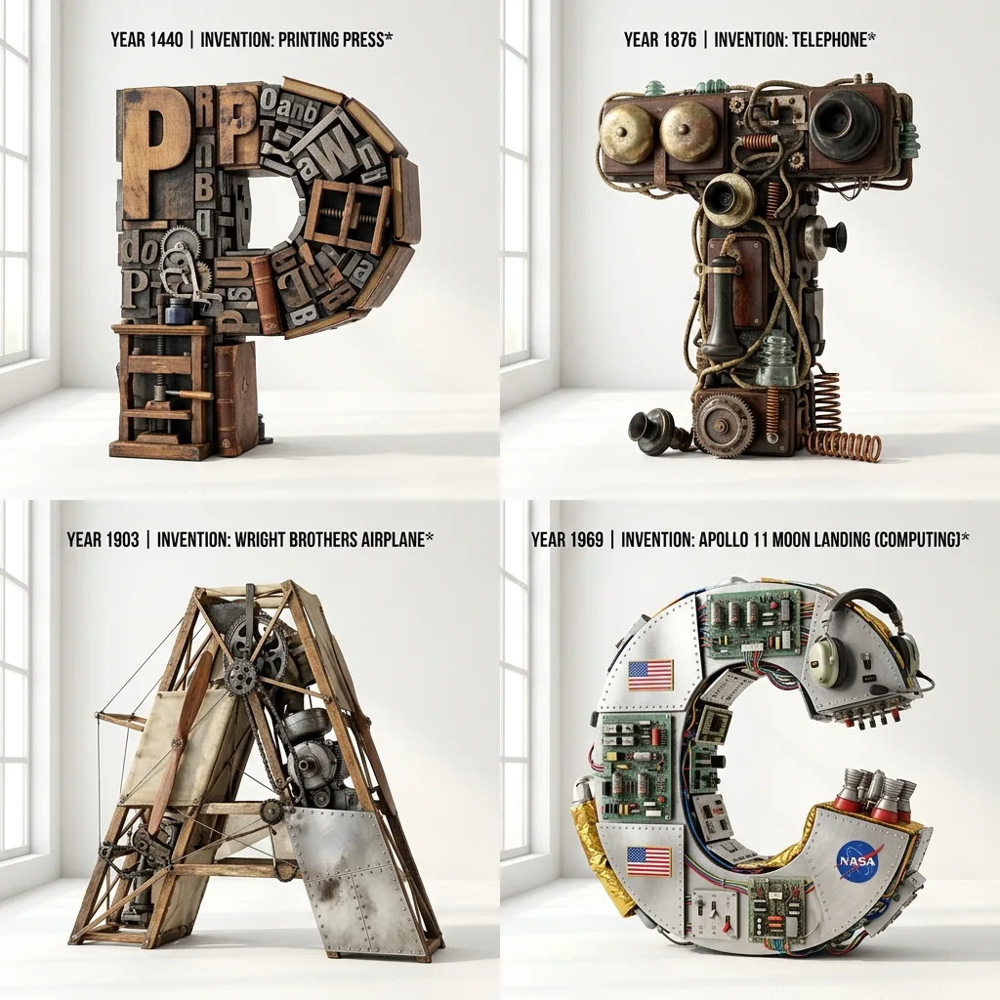

# 2x2 grid, do this for 4 important years

[← Back to the collection](../../README.md) · Category: [Illustration & 3D](../../gallery/illustration-3d.md) · Model: `Vinano Image Pro` · ID: `vn-00408`

<a href="https://vinano.ai?utm_source=github&utm_medium=readme&utm_campaign=awesome-image-video-prompts-updating&utm_content=prompt-page-image"></a>

<sub>Preview generated with <a href="https://vinano.ai?utm_source=github&utm_medium=readme&utm_campaign=awesome-image-video-prompts-updating&utm_content=prompt-page-caption">vinano.ai</a></sub>

## Prompt

```text
2x2 grid, do this for 4 important years in history and their most important inventions { Anchor: `[Letter/Number]:: [Era/Theme (e.g., 1980s Retro Tech / Victorian Steampunk)]::4`
 Morphology: `3D Typographic sculpture of [Letter/Number], character shape defined by a dense pile of [Era/Theme] objects, chaotic but legible assemblage, graphic design asset::3`
 Material Physics: `Textures of [Era/Theme] objects (plastic, rust, wood), occlusion between stacked items, realistic scale of constituent parts forming the glyph::3`
 Illumination: `Three-point studio lighting, softbox overhead, clean background for isolation::2`
 Render Stack: `Cinema 4D render, isometric or front-facing, ambient occlusion, 8k, Adobe Substance material suite::1`
 Negative: `[Illegible, flat font, 2D, handwriting, paper, messy background, floating objects]:: -1`}

Emphasise material texture and natural light so the final frame feels tactile and premium.
```

## Try it on vinano.ai

1. Copy the prompt above.
2. Open **[vinano.ai](https://vinano.ai?utm_source=github&utm_medium=readme&utm_campaign=awesome-image-video-prompts-updating&utm_content=prompt-page-try)**, paste it into the image generator and pick a model.
3. Swap any placeholders (brand, product, city, person…) for your own details, then generate.

More prompts like this: [Illustration & 3D gallery](../../gallery/illustration-3d.md) · [all categories](../../README.md#contents)
