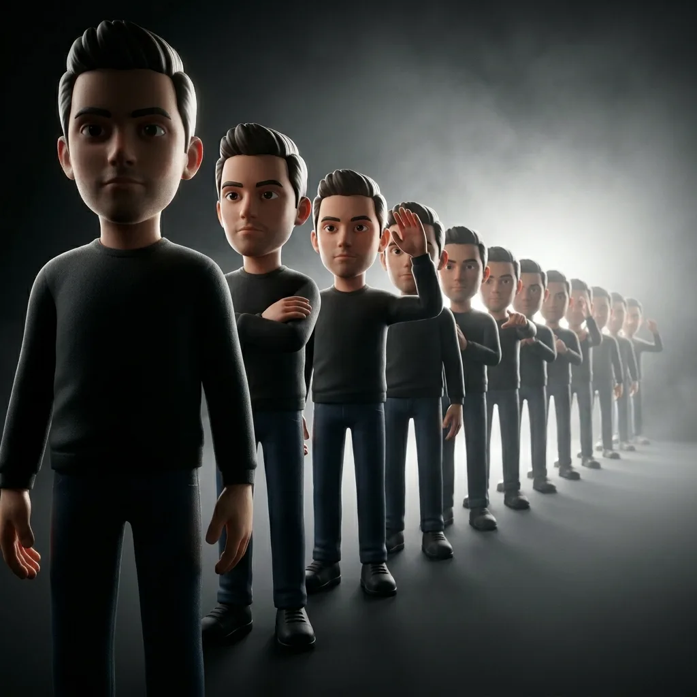

# Collectible-style 3D render of a linear procession of twelve

[← Back to the collection](../../README.md) · Category: [Illustration & 3D](../../gallery/illustration-3d.md) · Model: `Vinano Image v2` · ID: `vn-00409`

<a href="https://vinano.ai?utm_source=github&utm_medium=readme&utm_campaign=awesome-image-video-prompts-updating&utm_content=prompt-page-image"></a>

<sub>Preview generated with <a href="https://vinano.ai?utm_source=github&utm_medium=readme&utm_campaign=awesome-image-video-prompts-updating&utm_content=prompt-page-caption">vinano.ai</a></sub>

## Prompt

```text
A detailed, collectible-style 3D render of a linear procession of twelve identical figures, viewed in a dynamic diagonal 3/4 perspective down the line.

The figures are arranged on a dark, gradient studio floor a progressively shallower depth of field, making the furthest characters less detailed.
Specific Pose Sequence:

The procession must follow a distinct sequence of poses along the line:
The first and closest figure stands arms at their sides.

The second figure stands arms crossed over their chest.

The third figure stands one hand raised in a salute or wave.

The subsequent receding figures doing different poses.
Lighting and Atmosphere:

The scene features dramatic, atmospheric backlighting from a powerful source behind the furthest characters, creating a bright halo and deep rim-lighting, combined a strong, texturing haze or fog. Dramatic, focused front-side lighting illuminates the features of the nearest character. The background fades to complete shadow.
Fixed Elements:

The overall style is a high-end, textured, 3D vinyl toy aesthetic.
Camera:

Low-to-medium camera angle looking down the diagonal line.
Camera & Framing Refinement (CRITICAL):

Shot a close-range 28–35mm lens to introduce natural perspective compression without distortion.

The camera is positioned slightly below chest level of the first figure and very close to it, creating strong foreground dominance.
The first figure occupies approximately 65–75% of the frame height and must be tightly cropped at knee level. The feet of the first figure must NOT be visible.

The head of the first figure sits very close to the top edge of the frame minimal breathing room. The figure should feel slightly too large for the frame, as if it cannot fully fit inside.
Subsequent figures progressively reveal more of their full bodies as they recede into depth.
The diagonal line of figures must start large in the foreground (left side of frame) and recede tightly into the background (right side), each figure overlapping slightly the next.

The camera is not centered to the line. It is offset to the left, looking across the figures, not directly along them.
Spacing between figures compresses progressively toward the background, enhancing depth and scale illusion.

No wide empty gaps between characters. The line must feel dense and continuous.
2D to 3D Translation (ONLY if input is 2D artwork):

If the uploaded reference is 2D (illustration, anime, flat graphic, cel-shaded), convert it into a fully realized 3D cinematic form while preserving exact identity fidelity.
• Maintain exact head shape, eye design, spacing, and proportions

• Preserve original stylization, do NOT add realism that alters design language

• Translate linework into subtle surface geometry or shading transitions

• Keep original colors, expressed through physically believable materials

• Convert flat shading into controlled cinematic light falloff
The result must feel physically real, not redesigned.
ar 1:1

Aim for an editorial, design-driven look with deliberate negative space.
```

## Try it on vinano.ai

1. Copy the prompt above.
2. Open **[vinano.ai](https://vinano.ai?utm_source=github&utm_medium=readme&utm_campaign=awesome-image-video-prompts-updating&utm_content=prompt-page-try)**, paste it into the image generator and pick a model.
3. Swap any placeholders (brand, product, city, person…) for your own details, then generate.

More prompts like this: [Illustration & 3D gallery](../../gallery/illustration-3d.md) · [all categories](../../README.md#contents)
