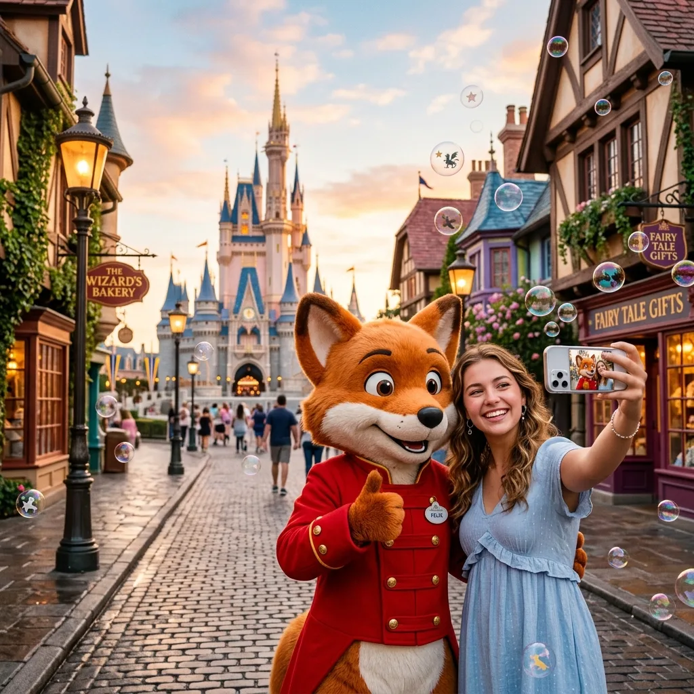

# Joyful, cinematic fantasy photograph set in a magical fairytale

[← Back to the collection](../../README.md) · Category: [Illustration & 3D](../../gallery/illustration-3d.md) · Model: `Vinano Image v2` · ID: `vn-00410`

<a href="https://vinano.ai?utm_source=github&utm_medium=readme&utm_campaign=awesome-image-video-prompts-updating&utm_content=prompt-page-image"></a>

<sub>Preview generated with <a href="https://vinano.ai?utm_source=github&utm_medium=readme&utm_campaign=awesome-image-video-prompts-updating&utm_content=prompt-page-caption">vinano.ai</a></sub>

## Prompt

```text
{
 "Objective": "Create a joyful, cinematic fantasy photograph set in a magical fairytale theme park"
 "Type": "Young woman",
 "Pose": "Taking a selfie at arm’s length",
 "Expression": "Warm, joyful smile",
 "Clothing": "Light blue dress",
 "Action": "Holding a smartphone, facing the camera"
 },
 "SecondarySubject": {
 "Type": "Anthropomorphic fox mascot",
 "Appearance": "Cute, friendly fox character",
 "Clothing": "Red jacket",
 "Pose": "Standing beside the woman, giving a thumbs-up",
 "Emotion": "Playful and welcoming"
 }
 },
 "SceneDescription": {
 "Location": "Magical fairytale theme park",
 "Foreground": "Woman and fox mascot posing for a selfie",
 "Background": {
 "Landmark": "Grand fairytale castle at the end of the street",
 "Street": "Charming cobblestone road",
 "Architecture": "Classic European-style buildings",
 "LightingElements": "Glowing vintage street lamps"
 },
 "AtmosphericDetails": {
 "FloatingElements": "Soap bubbles drifting through the air",
 "MagicalAccents": "Some bubbles contain tiny whimsical silhouettes",
 "Mood": "Whimsical, joyful, storybook magic"
 }
 },
 "LightingAndMood": {
 "TimeOfDay": "Golden hour",
 "LightingStyle": "Warm highlights gentle shadows",
 "Sky": "Soft pastel tones",
 "OverallMood": "Dreamy, uplifting, cinematic fantasy realism"
 },
 "PhotographyStyle": {
 "Genre": "Theme park photography",
 "Composition": "Cinematic framing strong depth",
 "DepthOfField": "Shallow depth of field",
 "DetailLevel": "Ultra-detailed textures",
 "ColorGrading": "Vibrant yet soft, pastel-enhanced",
 "Resolution": "High resolution, sharp focus on subjects"
 },
 "ArtDirection": {
 "Style": "Dreamy fantasy realism",
 "VisualTone": "Joyful, magical, immersive",
 "RealismBalance": "true-to-life photorealistic subtle fantasy elements"
 },
 "NegativePrompt": ["dark mood",
 "horror",
 "low resolution",
 "blurry faces",
 "harsh shadows",
 "oversaturated colors",
 "distorted anatomy",
 "uncanny characters"],
 "ResponseFormat": {
 "Type": "Single image",
 "Orientation": "Portrait",
 "AspectRatio": "2:3"
 }
}

Aim for an editorial, design-driven look with deliberate negative space.
```

## Try it on vinano.ai

1. Copy the prompt above.
2. Open **[vinano.ai](https://vinano.ai?utm_source=github&utm_medium=readme&utm_campaign=awesome-image-video-prompts-updating&utm_content=prompt-page-try)**, paste it into the image generator and pick a model.
3. Swap any placeholders (brand, product, city, person…) for your own details, then generate.

More prompts like this: [Illustration & 3D gallery](../../gallery/illustration-3d.md) · [all categories](../../README.md#contents)
