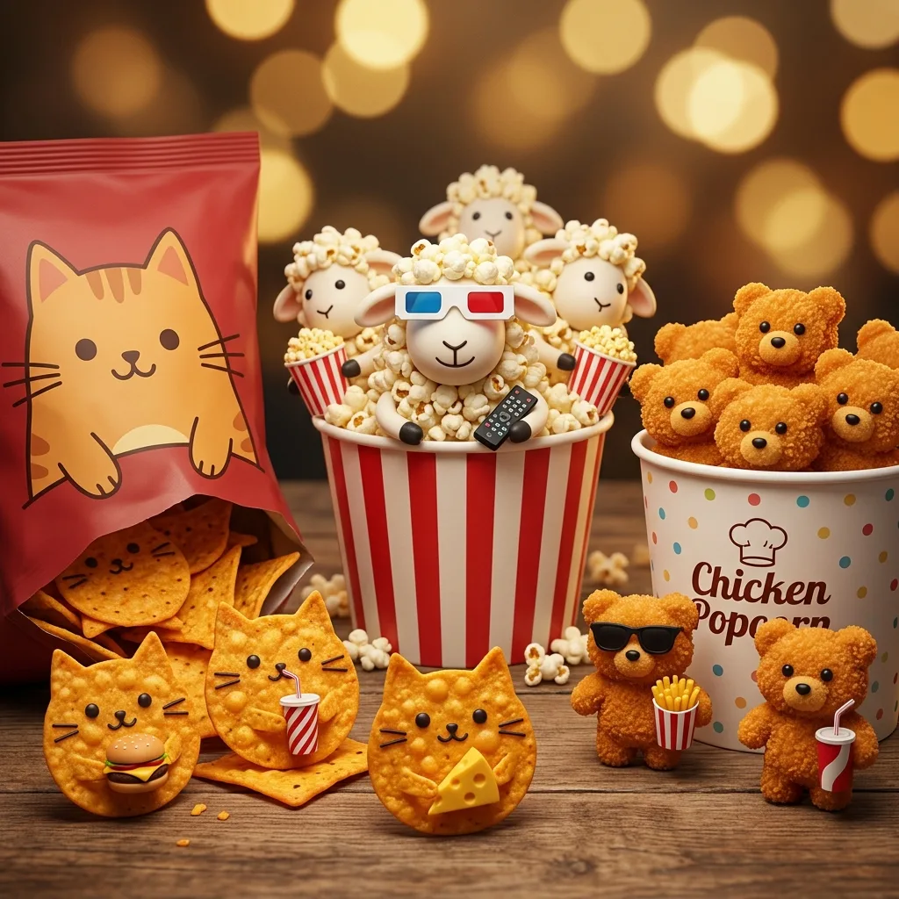

# 3:4 vertical , image quality

[← Back to the collection](../../README.md) · Category: [Illustration & 3D](../../gallery/illustration-3d.md) · Model: `Vinano Image v2` · ID: `vn-00412`

<a href="https://vinano.ai?utm_source=github&utm_medium=readme&utm_campaign=awesome-image-video-prompts-updating&utm_content=prompt-page-image"></a>

<sub>Preview generated with <a href="https://vinano.ai?utm_source=github&utm_medium=readme&utm_campaign=awesome-image-video-prompts-updating&utm_content=prompt-page-caption">vinano.ai</a></sub>

## Prompt

```text
{
 "global_settings": {
 "resolution": "8K ultra high definition",
 "aspect_ratio": "3:4 vertical",
 "image_quality": "extreme detail, ultra sharp focus",
 "lighting_style": "warm filmic, cinematic lighting golden bokeh background",
 "depth_of_field": "shallow depth of field, strong subject separation",
 "render_style": "AI-edited, hyper-detailed, true-to-life photorealistic stylized realism",
 "color_grading": "warm tones, golden highlights, soft shadows",
 "background": "out-of-focus golden circular bokeh lights"
 },

 "Module_1_Image_1_Style": {
 "subject": "Cat-shaped tortilla chips",
 "primary_container": {
 "type": "red paper snack bag",
 "design": "large illustrated cartoon cat on front",
 "graphics": "simple facial features, soft pastel tones",
 "material": "matte paper texture"
 },
 "chip_details": {
 "shape": "cat heads pointed ears",
 "color": "golden-orange fried texture",
 "surface": "crispy, bubbled, slightly uneven",
 "facial_features": {
 "eyes": "small black circular dots",
 "mouth": "simple curved line",
 "whiskers": "thin dark lines"
 }
 },
 "poses_and_interactions": {
 "one_chip": "holding a miniature cheeseburger",
 "one_chip": "holding a red-and-white striped soda cup straw",
 "one_chip": "holding a triangular cheese slice",
 "foreground_chips": "sitting outside the bag on surface"
 },
 "composition": {
 "camera_angle": "slightly above eye level",
 "framing": "tight vertical framing",
 "focus": "sharp on chips, blurred background"
 }
 },

 "Module_2_Image_2_Style": {
 "subject": "Sheep-shaped popcorn figures",
 "primary_container": {
 "type": "classic popcorn bucket",
 "design": "red and white vertical stripes",
 "material": "cardboard soft matte finish"
 },
 "sheep_details": {
 "body": "made entirely of popcorn kernels",
 "head": "smooth white rounded face",
 "ears": "small rounded ears pale yellow inner tone",
 "eyes": "tiny black dots",
 "mouth": "thin curved smile line"
 },
 "poses_and_accessories": {
 "one_sheep": "wearing red-blue 3D glasses",
 "one_sheep": "holding a small popcorn bucket",
 "one_sheep": "holding a black TV remote",
 "multiple_sheep": "peeking from behind popcorn pile"
 },
 "composition": {
 "layering": "sheep stacked and clustered",
 "foreground": "extra popcorn scattered around base",
 "focus": "central sheep in sharp focus"
 }
 },

 "Module_3_Image_3_Style": {
 "subject": "Bear-shaped chicken popcorn nuggets",
 "primary_container": {
 "type": "white popcorn-style bucket",
 "branding": "text reads 'Chicken Popcorn'",
 "graphics": "simple chef hat icon above text",
 "decoration": "small colored polka dots"
 },
 "nugget_details": {
 "shape": "teddy bear silhouettes",
 "color": "golden-brown fried coating",
 "texture": "crunchy breaded surface",
 "facial_features": {
 "eyes": "small black beads",
 "nose": "rounded black nose",
 "mouth": "tiny dark line"
 }
 },
 "poses_and_accessories": {
 "one_nugget": "wearing black sunglasses",
 "one_nugget": "holding fries in red-striped cup",
 "one_nugget": "holding soda cup straw",
 "foreground_nuggets": "standing outside bucket"
 },
 "composition": {
 "camera_distance": "medium close-up",
 "bucket_position": "centered vertically",
 "lighting": "warm highlights emphasizing texture''

Maintain consistent colour harmony and crisp focus across the whole frame.
```

## Try it on vinano.ai

1. Copy the prompt above.
2. Open **[vinano.ai](https://vinano.ai?utm_source=github&utm_medium=readme&utm_campaign=awesome-image-video-prompts-updating&utm_content=prompt-page-try)**, paste it into the image generator and pick a model.
3. Swap any placeholders (brand, product, city, person…) for your own details, then generate.

More prompts like this: [Illustration & 3D gallery](../../gallery/illustration-3d.md) · [all categories](../../README.md#contents)
