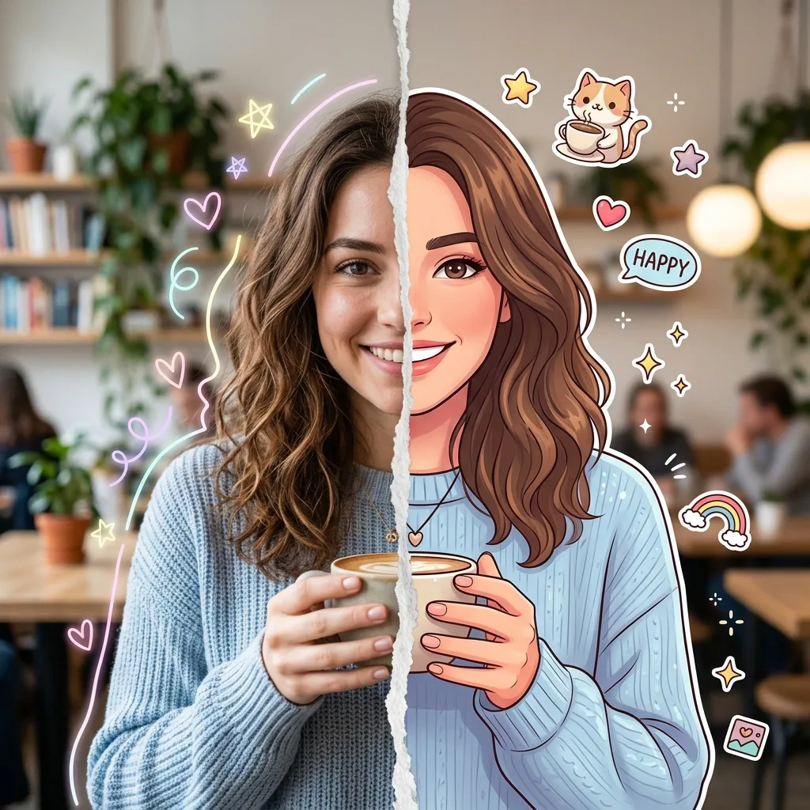

# High-detail 8K split-style composition where the subject is divided

[← Back to the collection](../../README.md) · Category: [Illustration & 3D](../../gallery/illustration-3d.md) · Model: `Vinano Image v2` · ID: `vn-00426`

<a href="https://vinano.ai?utm_source=github&utm_medium=readme&utm_campaign=awesome-image-video-prompts-updating&utm_content=prompt-page-image"></a>

<sub>Preview generated with <a href="https://vinano.ai?utm_source=github&utm_medium=readme&utm_campaign=awesome-image-video-prompts-updating&utm_content=prompt-page-caption">vinano.ai</a></sub>

## Prompt

```text
High-detail 8K split-style composition where the subject is divided vertically into two halves.
LEFT SIDE:
Keep the original photo fully realistic. Preserve natural lighting, textures, and fine details. Slightly enhance sharpness and clarity. Add subtle hand-drawn doodle outlines (soft pastel or neon lines) around the subject for a creative aura.
RIGHT SIDE:
Transform the same subject into a stylized cartoon/digital illustration. Maintain the exact same pose, angle, and facial expression. Use clean lineart, soft shading, and pastel or vibrant colors in a modern cute style (chibi / semi-realistic). Add small decorative elements like sticker-style doodles, cute icons, or mini characters floating around.
BACKGROUND (IMPORTANT):
Keep the ORIGINAL background unchanged on BOTH sides. Do not replace, redraw, or stylize the background. Maintain consistency across the entire image.
CENTER DIVISION:
Add a vertical torn-paper or glitch-style transition separating the realistic and illustrated halves.
STYLE:
modern digital art, crisp composition, soft, diffused lighting, aesthetically pleasing, social media style
QUALITY: 8K resolution, ultra-detailed.

Aim for an editorial, design-driven look with deliberate negative space.
```

## Try it on vinano.ai

1. Copy the prompt above.
2. Open **[vinano.ai](https://vinano.ai?utm_source=github&utm_medium=readme&utm_campaign=awesome-image-video-prompts-updating&utm_content=prompt-page-try)**, paste it into the image generator and pick a model.
3. Swap any placeholders (brand, product, city, person…) for your own details, then generate.

More prompts like this: [Illustration & 3D gallery](../../gallery/illustration-3d.md) · [all categories](../../README.md#contents)
