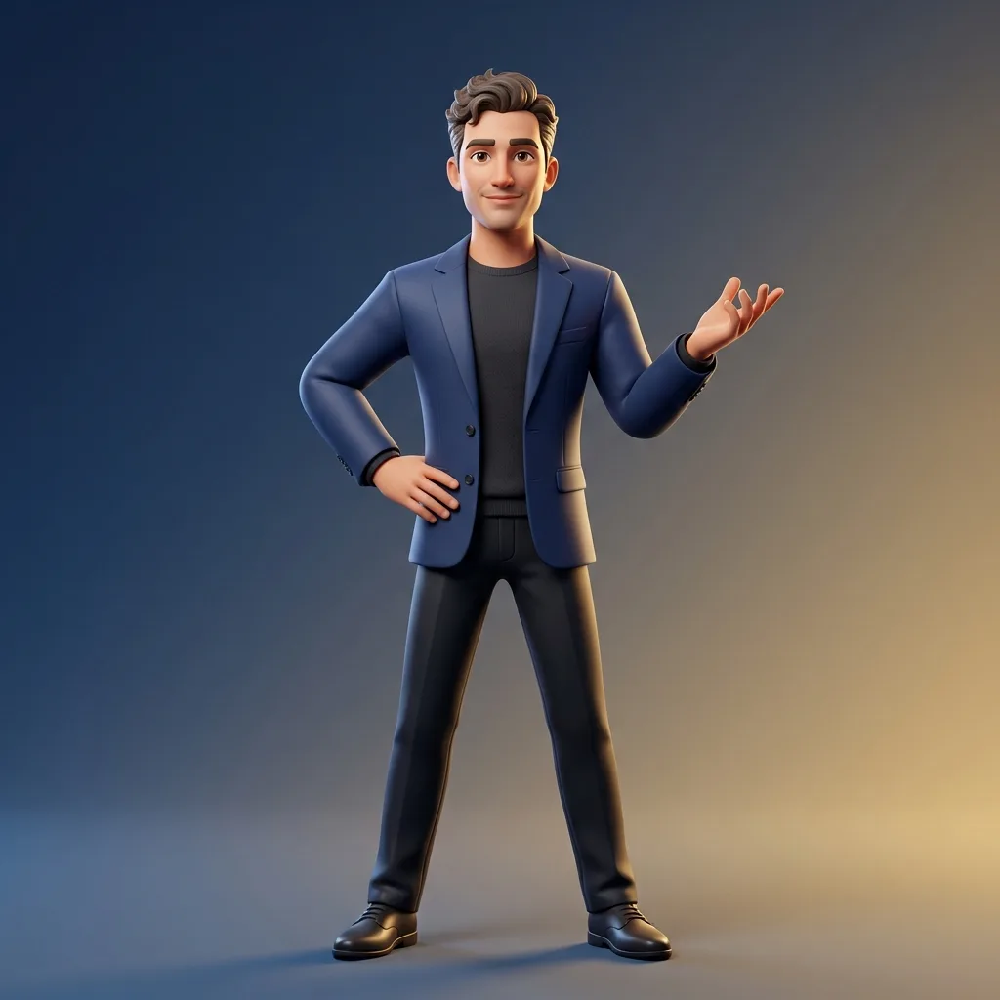

# Transform the referenced person into a premium stylized 3D

[← Back to the collection](../../README.md) · Category: [Illustration & 3D](../../gallery/illustration-3d.md) · Model: `Vinano Image v2` · ID: `vn-00428`

<a href="https://vinano.ai?utm_source=github&utm_medium=readme&utm_campaign=awesome-image-video-prompts-updating&utm_content=prompt-page-image"></a>

<sub>Preview generated with <a href="https://vinano.ai?utm_source=github&utm_medium=readme&utm_campaign=awesome-image-video-prompts-updating&utm_content=prompt-page-caption">vinano.ai</a></sub>

## Prompt

```text
Transform the referenced person into a premium stylized 3D animated character, full body hero shot, standing confidently in the exact center of the frame. Preserve the exact identity and key facial details as closely as possible, including face shape, eyes, nose, mouth, hairstyle, skin tone, and expression, without redesigning the face. Use soft rounded geometry, smooth polished materials, subtle glossy shading, and a modern premium 3D animation style. The pose must feel dynamic, charismatic, and heroic, not stiff. Let the arms and hands naturally perform an expressive gesture that best suits the character’s body shape, personality, and visual balance, chosen intelligently for the most flattering and appealing result. Keep the full body fully visible while the character still feels close, clear, and strongly present to the camera. Use a clean solid background or a soft gradient [BACKGROUND COLOR]. Studio-quality lighting, soft grounded shadow, strong subject separation, clean premium composition, ultra refined, highly detailed, no props, no text, no logos, no watermark Maintain consistent colour harmony and crisp focus across the whole frame.
```

## Try it on vinano.ai

1. Copy the prompt above.
2. Open **[vinano.ai](https://vinano.ai?utm_source=github&utm_medium=readme&utm_campaign=awesome-image-video-prompts-updating&utm_content=prompt-page-try)**, paste it into the image generator and pick a model.
3. Swap any placeholders (brand, product, city, person…) for your own details, then generate.

More prompts like this: [Illustration & 3D gallery](../../gallery/illustration-3d.md) · [all categories](../../README.md#contents)
