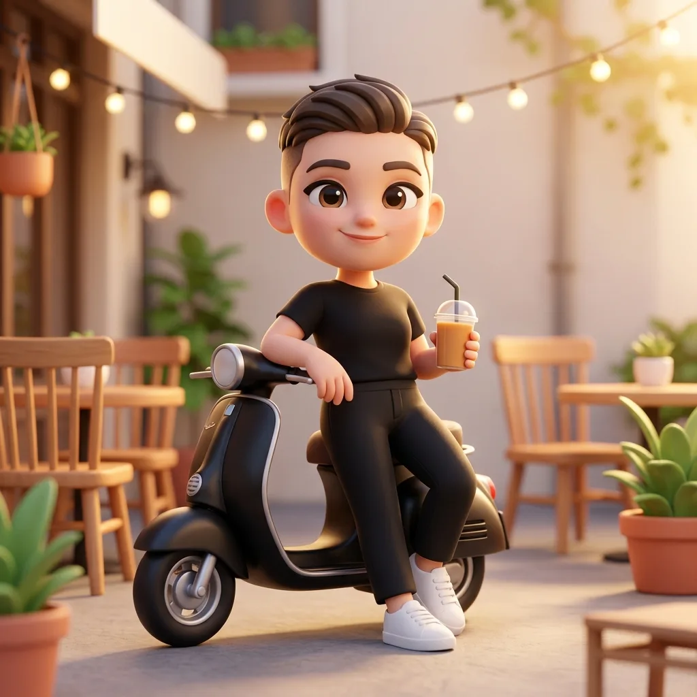

# Cute 3D chibi-style character of the uploaded image leaning

[← Back to the collection](../../README.md) · Category: [Illustration & 3D](../../gallery/illustration-3d.md) · Model: `Vinano Image v2` · ID: `vn-00429`

<a href="https://vinano.ai?utm_source=github&utm_medium=readme&utm_campaign=awesome-image-video-prompts-updating&utm_content=prompt-page-image"></a>

<sub>Preview generated with <a href="https://vinano.ai?utm_source=github&utm_medium=readme&utm_campaign=awesome-image-video-prompts-updating&utm_content=prompt-page-caption">vinano.ai</a></sub>

## Prompt

```text
A cute 3D chibi-style character of the uploaded image leaning against a parked mini chibi scooter, wearing a clean monochrome outfit a t-shirt, straight-fit pants, and refined minimalist sneakers, holding a takeaway juice cup a relaxed confident smile, big head and expressive eyes, modern fade haircut, set in a cozy café courtyard wooden chairs, warm golden sunlight, soft depth of field, pastel color palette, smooth rounded proportions, subtle texture detailing, global illumination gentle rim light, soft natural shadows, playful yet premium Pixar-quality 3D render, toy-like finish, Google Gemini cinematic but cozy mood, ultra-clean high-detail output, Instagram-ready composition, square aspect ratio 1:1 Aim for an editorial, design-driven look with deliberate negative space.
```

## Try it on vinano.ai

1. Copy the prompt above.
2. Open **[vinano.ai](https://vinano.ai?utm_source=github&utm_medium=readme&utm_campaign=awesome-image-video-prompts-updating&utm_content=prompt-page-try)**, paste it into the image generator and pick a model.
3. Swap any placeholders (brand, product, city, person…) for your own details, then generate.

More prompts like this: [Illustration & 3D gallery](../../gallery/illustration-3d.md) · [all categories](../../README.md#contents)
