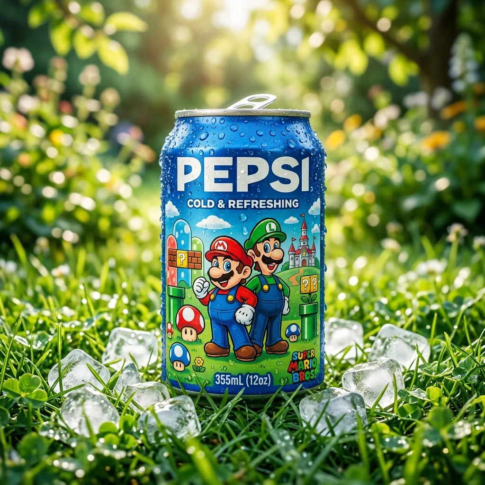

# Product photography of a chilled blue Pepsi can placed

[← Back to the collection](../../README.md) · Category: [Illustration & 3D](../../gallery/illustration-3d.md) · Model: `Vinano Image v2` · ID: `vn-00433`

<a href="https://vinano.ai?utm_source=github&utm_medium=readme&utm_campaign=awesome-image-video-prompts-updating&utm_content=prompt-page-image"></a>

<sub>Preview generated with <a href="https://vinano.ai?utm_source=github&utm_medium=readme&utm_campaign=awesome-image-video-prompts-updating&utm_content=prompt-page-caption">vinano.ai</a></sub>

## Prompt

```text
Ultra-realistic product photography of a chilled blue Pepsi can placed upright on fresh green grass, covered cold water droplets and condensation. Ice cubes scattered around the base. The can features a vibrant, colorful illustration of Mario and Luigi standing together in a whimsical mushroom kingdom scene red and blue mushrooms, green pipes, question blocks, and a castle in the background. Bright, cheerful, cartoon-style artwork printed on the can.

Shot outdoors in natural daylight a soft, blurred garden background (bokeh effect), bright green foliage and sunlight filtering through trees. Shallow depth of field, macro detail, high contrast, vivid colors, sharp focus on the can, cinematic product lighting, summer refreshment mood, commercial advertising style, ultra-detailed, 8K quality, true-to-life photorealistic, centered composition, vertical framing.

Preserve realistic proportions and depth for a confident, professional finish.
```

## Try it on vinano.ai

1. Copy the prompt above.
2. Open **[vinano.ai](https://vinano.ai?utm_source=github&utm_medium=readme&utm_campaign=awesome-image-video-prompts-updating&utm_content=prompt-page-try)**, paste it into the image generator and pick a model.
3. Swap any placeholders (brand, product, city, person…) for your own details, then generate.

More prompts like this: [Illustration & 3D gallery](../../gallery/illustration-3d.md) · [all categories](../../README.md#contents)
